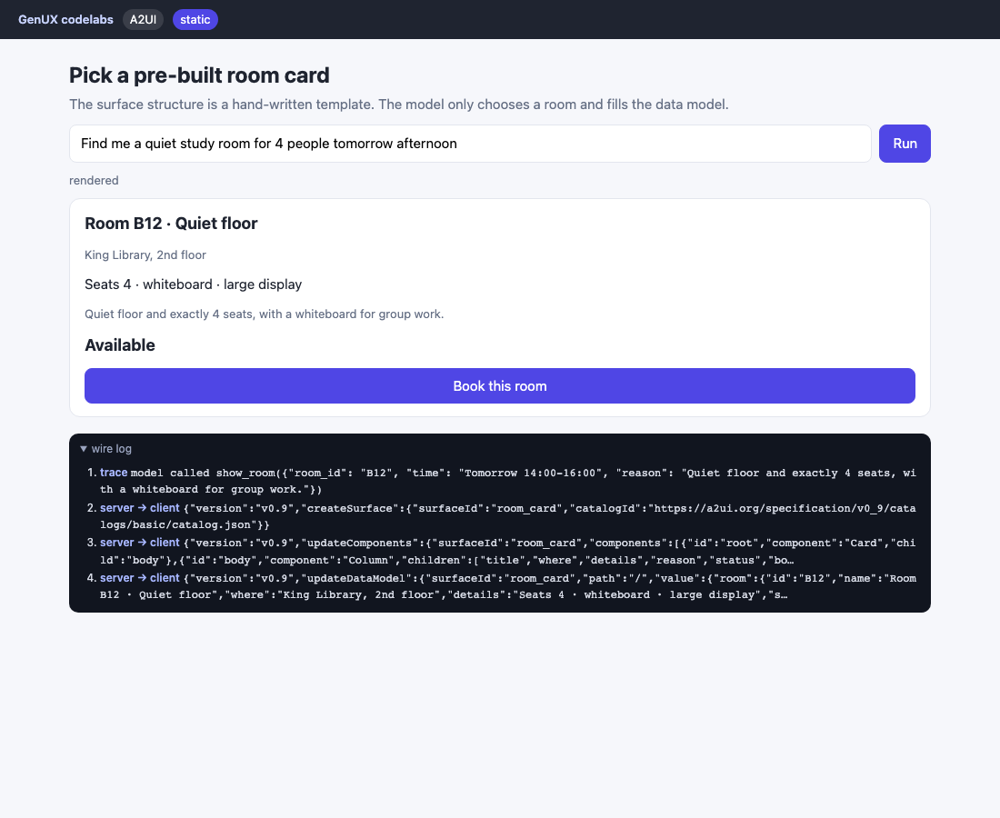
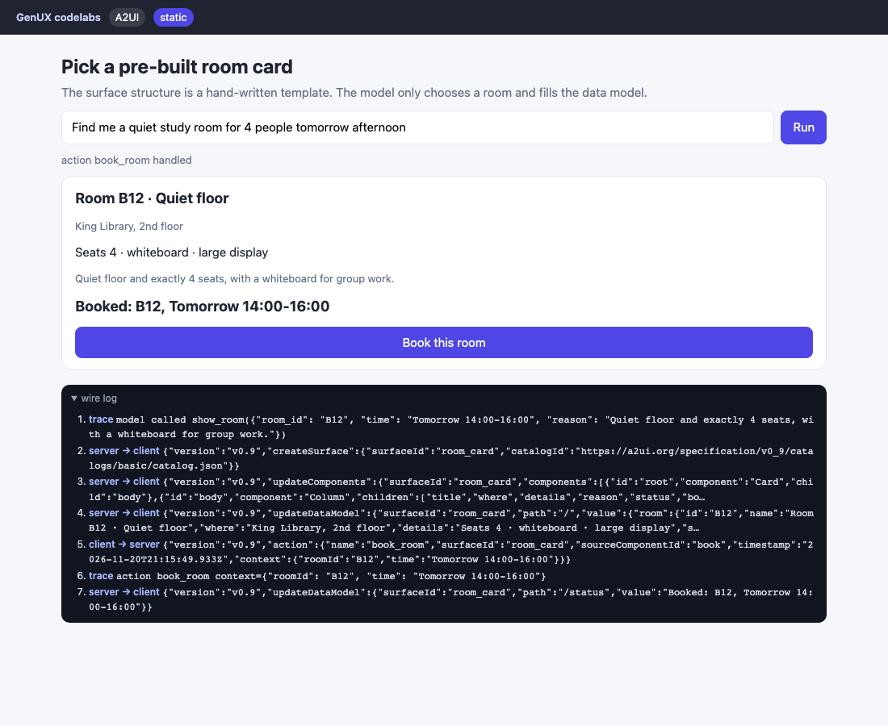

# A2UI · static: a pre-built surface, the model fills the data

**Mode: static.** A developer wrote the surface ahead of time in `room_card.jsonl`. The model calls one tool, `show_room`. The server sends the fixed template, then one `updateDataModel` built from the tool arguments and the library's own room list. The model never writes a component.

## Run it

```bash
python 01_a2ui/1_static/demo.py
```

Or start `python serve.py` and open `http://127.0.0.1:8000/01_a2ui/1_static/`.

## Execution

The demo starts the server, opens the page in headless Chromium, takes a screenshot, clicks **Book this room** and records every message on the wire:

<!-- OUTPUT -->
```text
$ python 01_a2ui/1_static/demo.py

POST api/run  {"prompt":"Find me a quiet study room for 4 people tomorrow afternoon"}
  <- trace {"text":"model called show_room({\"room_id\": \"B12\", \"time\": \"Tomorrow 14:00-16:00\", \"reason\": \"Quiet floor and exactly …
  <- createSurface {"surfaceId":"room_card","catalogId":"https://a2ui.org/specification/v0_9/catalogs/basic/catalog.json"}
  <- updateComponents {"surfaceId":"room_card","components":[{"id":"root","component":"Card","child":"body"},{"id":"body","component":"Column","childre…
  <- updateDataModel {"surfaceId":"room_card","path":"/","value":{"room":{"id":"B12","name":"Room B12 · Quiet floor","where":"King Library, 2nd floor"…
POST api/action  {"version":"v0.9","action":{"name":"book_room","surfaceId":"room_card","sourceComponentId":"book","timestamp"…
  <- trace {"text":"action book_room context={\"roomId\": \"B12\", \"time\": \"Tomorrow 14:00-16:00\"}"}
  <- updateDataModel {"surfaceId":"room_card","path":"/status","value":"Booked: B12, Tomorrow 14:00-16:00"}

screenshots: demo_before.png, demo.png   (2 request(s), 2.1s)
```
<!-- /OUTPUT -->

| After the first run | After clicking "Book this room" |
|---|---|
|  |  |

## Code walkthrough

### 1. The template is data, written by a developer

`room_card.jsonl` holds two envelopes. Every visible value is a binding into the data model, for example `"text": {"path": "/room/name"}`. The button's action context is bound too, so the click reports the room id and time from the data model, not from the model's text.

### 2. The model only chooses

`agent.py` gives the model one function-calling tool. The room id is an enum taken from the application's data:

```python
TOOLS = [tool("show_room", "Show one bookable study room in the room card.", {
    "room_id": {"type": "string", "enum": sorted(ROOMS)},
    "time": {"type": "string", "description": "the slot, e.g. 'Tomorrow 14:00-16:00'"},
    "reason": {"type": "string", "description": "one short sentence: why this room fits"},
})]
```

### 3. Structure from the template, data from the tool call

`agent.py` checks the arguments against `ROOMS`, then streams the template and a single data update. The room facts come from `rooms.py`, not from the model:

```python
        room = ROOMS.get(args.get("room_id"))
        if call["name"] != "show_room" or room is None:
            yield {"type": "trace", "text": "rejected: unknown tool or room"}
            continue
        yield from TEMPLATE                          # structure: fixed, written by a developer
        yield a2ui.update_data_model(SURFACE, "/", {  # data: the only part the model influenced
            "room": room, "time": args["time"], "reason": args["reason"], "status": "Available"})
```

### 4. The action changes data, not structure

`agent.py` answers the `book_room` action with one `updateDataModel` on `/status`. The client redraws, and the `status` Text, bound to `/status`, shows the new value:

```python
    BOOKED.add((ctx["roomId"], ctx["time"]))
    yield a2ui.update_data_model(SURFACE, "/status", f"Booked: {ctx['roomId']}, {ctx['time']}")
```

### 5. The page

`app.js` is five lines of configuration. The routing, rendering and action building live in `../client.mjs` and `../a2ui.mjs`:

```js
startA2UIPage({
  mode: "static",
```

## What to notice

- The wire log shows exactly one `updateComponents`, ever. Booking sends 1 small envelope.
- The model's output is about 30 tokens: an enum value and two strings.
- Safety is structural: the model cannot add a component, because it never writes one.
