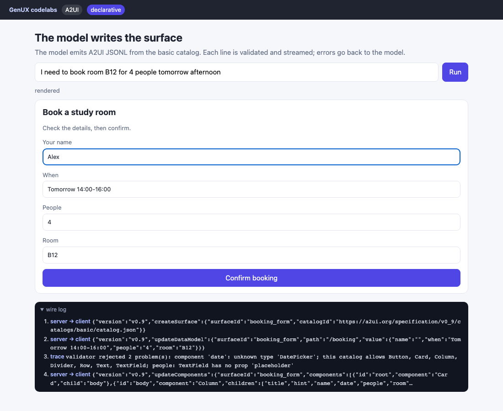
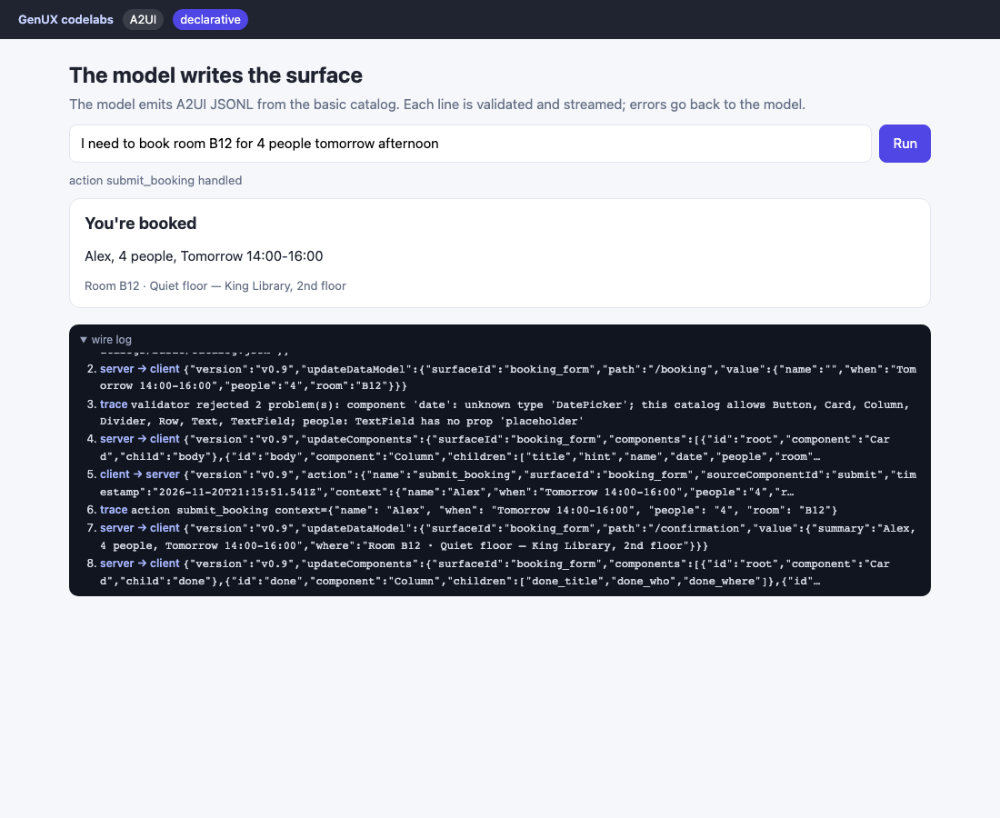

# A2UI · declarative: the model writes the surface as JSONL

**Mode: declarative.** The model writes A2UI envelopes itself, one JSON object per line, using any component in the basic catalog. The server streams the output, validates each line, forwards valid envelopes immediately and sends the errors back to the model. A form submit returns as an `action`; the model writes the confirmation surface, and the server fills its data.

## Run it

```bash
python 01_a2ui/2_declarative/demo.py
```

## Execution

The demo types "Alex" into the form, takes a screenshot and clicks **Confirm booking**. Note the validator trace: the model's first try used a `DatePicker` (not in the catalog) and a `placeholder` prop (not allowed).

<!-- OUTPUT -->
```text
$ python 01_a2ui/2_declarative/demo.py

POST api/run  {"prompt":"I need to book room B12 for 4 people tomorrow afternoon"}
  <- createSurface {"surfaceId":"booking_form","catalogId":"https://a2ui.org/specification/v0_9/catalogs/basic/catalog.json"}
  <- updateDataModel {"surfaceId":"booking_form","path":"/booking","value":{"name":"","when":"Tomorrow 14:00-16:00","people":"4","room":"B12"}}
  <- trace {"text":"validator rejected 2 problem(s): component 'date': unknown type 'DatePicker'; this catalog allows Button, Card, Column, …
  <- updateComponents {"surfaceId":"booking_form","components":[{"id":"root","component":"Card","child":"body"},{"id":"body","component":"Column","chil…
POST api/action  {"version":"v0.9","action":{"name":"submit_booking","surfaceId":"booking_form","sourceComponentId":"submit","…
  <- trace {"text":"action submit_booking context={\"name\": \"Alex\", \"when\": \"Tomorrow 14:00-16:00\", \"people\": \"4\", \"room\": \"B1…
  <- updateDataModel {"surfaceId":"booking_form","path":"/confirmation","value":{"summary":"Alex, 4 people, Tomorrow 14:00-16:00","where":"Room B12 · …
  <- updateComponents {"surfaceId":"booking_form","components":[{"id":"root","component":"Card","child":"done"},{"id":"done","component":"Column","chil…

screenshots: demo_before.png, demo.png   (2 request(s), 1.6s)
```
<!-- /OUTPUT -->

| The validated form | After "Confirm booking" |
|---|---|
|  |  |

## Code walkthrough

### 1. The catalog goes into the prompt

`agent.py` describes the envelopes and the allowed components to the model:

```python
SYSTEM = f"""You build user interfaces with A2UI {a2ui.VERSION}. Reply with JSONL only: one envelope per line.
Envelopes: createSurface, updateComponents, updateDataModel. Use catalogId {a2ui.BASIC_CATALOG}.
```

### 2. Validate while streaming

`agent.py` reads the stream chunk by chunk. Each completed line is parsed and checked; a valid envelope reaches the page before the model has finished:

```python
    for chunk in model.stream(messages):
        buffer += chunk
        while "\n" in buffer:
            line, buffer = buffer.split("\n", 1)
            msg = take(line)
            if msg:
                yield msg
```

### 3. Validation errors are a conversation, not a crash

`agent.py` gives the model three attempts. The errors become the next user message:

```python
        yield {"type": "trace", "text": f"validator rejected {len(errors)} problem(s): {'; '.join(errors)}"}
        messages += [{"role": "assistant", "content": "(previous output)"},
                     {"role": "user", "content": "Fix these A2UI errors and resend only the corrected envelopes:\n"
                      + "\n".join(errors)}]
```

The `createSurface` and `updateDataModel` lines were valid, so they were already on screen. Only the broken `updateComponents` was resent.

### 4. Two-way binding

The form's `TextField` components bind to `/booking/...`. In `../a2ui.mjs`, typing writes into the surface's data model, and the submit action reads the same paths:

```js
      setData: (path, value) => setPath(this.data, path, value), // two-way binding for inputs
```

### 5. The server checks the action, the model writes the next screen

`agent.py` refuses a submit without a name, an unknown room or too many people. On success the server writes the confirmation *data*, and the model writes the confirmation *structure*:

```python
    yield a2ui.update_data_model(SURFACE, "/confirmation", {   # data from the server, not the model
        "summary": f"{ctx['name']}, {people} people, {ctx['when']}", "where": f"{room['name']} — {room['where']}"})
    yield from stream_validated(model, messages, validator, [])
```

## What to notice

- The UI arrives in pieces: `createSurface` and data first, components after the fix.
- The model's output is about ten times larger than in the static mode, because it now writes structure.
- The confirmation text "Alex, 4 people…" comes from the action context, so a model cannot misquote the booking.

## Compared with static

Static sent a developer's template. Here the model chooses the layout, so the server needs a validator and a correction loop.
