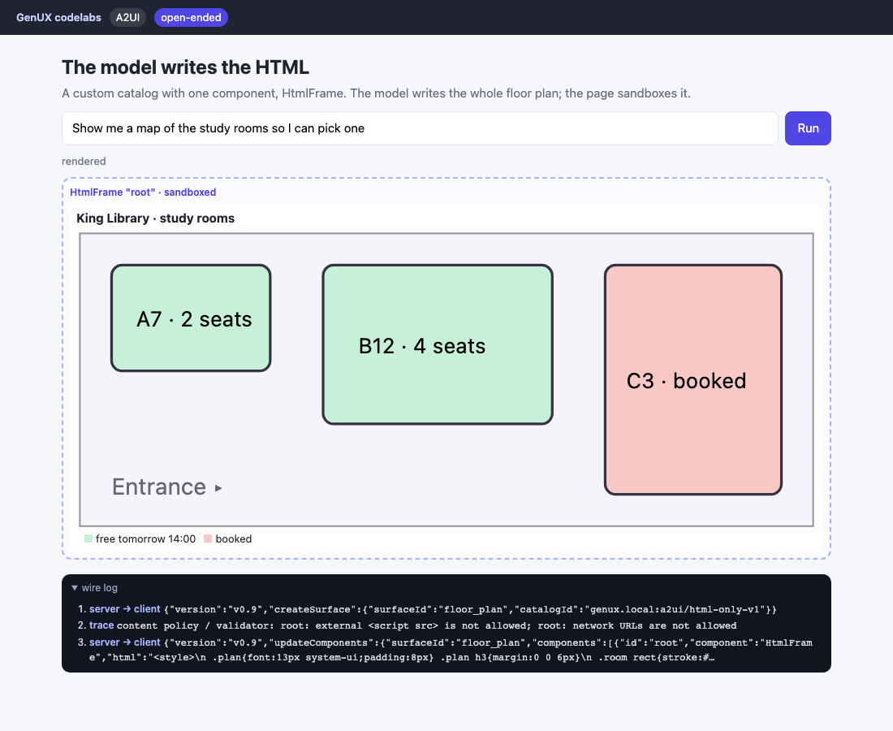
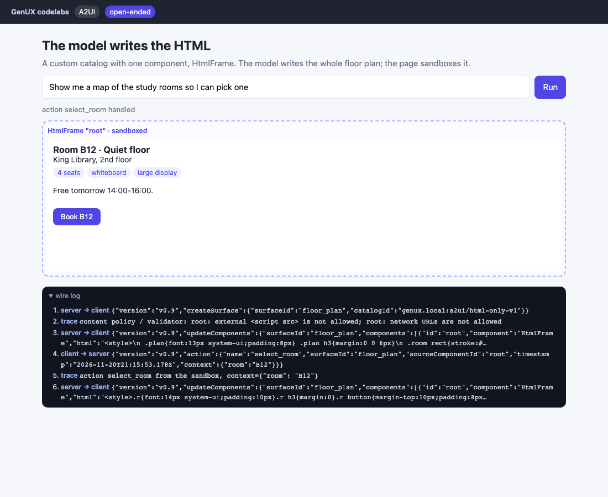
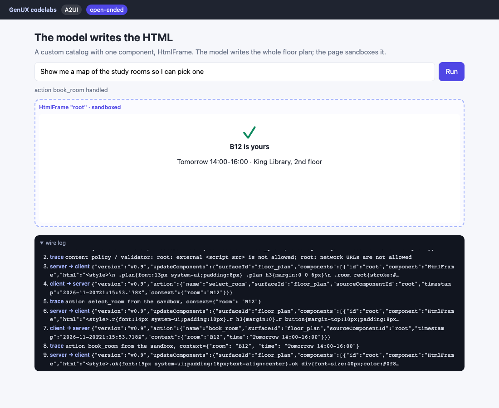

# A2UI · open-ended: one HtmlFrame, all model-written HTML

**Mode: open-ended.** The surface uses a custom catalog, `genux.local:a2ui/html-only-v1`, whose only component is `HtmlFrame(html, height)`. The model writes the whole floor plan as HTML, CSS and JavaScript. The server checks the HTML against a content policy; the page shows it in a sandboxed iframe. A click inside the frame becomes an ordinary A2UI `action`.

## Run it

```bash
python 01_a2ui/3_open_ended/demo.py
```

## Execution

The demo clicks room B12 inside the sandbox, then **Book B12**. The first model reply tried to load a script from a CDN; the policy refused it and the model retried. The table at the end compares the model output size of the three modes for this task.

<!-- OUTPUT -->
```text
$ python 01_a2ui/3_open_ended/demo.py

POST api/run  {"prompt":"Show me a map of the study rooms so I can pick one"}
  <- createSurface {"surfaceId":"floor_plan","catalogId":"genux.local:a2ui/html-only-v1"}
  <- trace {"text":"content policy / validator: root: external <script src> is not allowed; root: network URLs are not allowed"}
  <- updateComponents {"surfaceId":"floor_plan","components":[{"id":"root","component":"HtmlFrame","html":"<style>\n .plan{font:13px system-ui;padding:…
POST api/action  {"version":"v0.9","action":{"name":"select_room","surfaceId":"floor_plan","sourceComponentId":"root","timesta…
  <- trace {"text":"action select_room from the sandbox, context={\"room\": \"B12\"}"}
  <- updateComponents {"surfaceId":"floor_plan","components":[{"id":"root","component":"HtmlFrame","html":"<style>.r{font:14px system-ui;padding:10px}.…
POST api/action  {"version":"v0.9","action":{"name":"book_room","surfaceId":"floor_plan","sourceComponentId":"root","timestamp…
  <- trace {"text":"action book_room from the sandbox, context={\"room\": \"B12\", \"time\": \"Tomorrow 14:00-16:00\"}"}
  <- updateComponents {"surfaceId":"floor_plan","components":[{"id":"root","component":"HtmlFrame","html":"<style>.ok{font:15px system-ui;padding:16px;…

model output size for one screen (tokens, estimated):
  static (tool call args)           32
  declarative (A2UI JSONL)         300
  open-ended (HtmlFrame HTML)      407

screenshots: demo_before.png, demo_room.png, demo.png   (3 request(s), 2.1s)
```
<!-- /OUTPUT -->

| Floor plan (model HTML) | After clicking B12 | After booking |
|---|---|---|
|  |  |  |

## Code walkthrough

### 1. A custom catalog with one component

`../a2ui.py` registers the catalog. A2UI lets a client support catalogs beyond the basic one; this one trades every guarantee for freedom:

```python
_HTML = {"HtmlFrame": ({"html"}, {"height"})}  # a custom component: model-written HTML
```

### 2. The model reports clicks through one function

`agent.py` tells the model the only way out of the frame is `genux.send`. The model's HTML uses it:

```python
 document.querySelectorAll(".room.free").forEach(g => g.addEventListener("click", () =>
   genux.send("action", {name: "select_room", context: {room: g.dataset.room}})));
```

### 3. Two layers of protection

The server runs `check_html` on every `HtmlFrame` (inside the validator). `../../shared/sandbox.py` blocks network URLs, external scripts, nested frames, navigation and storage:

```python
BLOCKED = [
    (re.compile(r"<script[^>]+src\s*=", re.I), "external <script src> is not allowed"),
    (re.compile(r"https?://", re.I), "network URLs are not allowed"),
```

The browser layer, `../../shared/js/sandbox.mjs`, gives the iframe an opaque origin and a Content Security Policy with no network:

```js
  frame.setAttribute("sandbox", "allow-scripts");
```

### 4. A sandbox message becomes an A2UI action

`../a2ui.mjs` accepts a message only from the frame it created, and wraps it in the standard envelope, naming the `HtmlFrame` as the source:

```js
    const fromSandbox = (componentId) => (type, payload) => {
      if (type === "action") onAction({ version: VERSION, action: { name: payload.name, surfaceId: this.id,
```

### 5. The server still decides

`agent.py` accepts only the two action names it offered and only known rooms:

```python
    if action["name"] not in ALLOWED_ACTIONS or action["context"].get("room") not in ROOMS:
        yield {"type": "trace", "text": "rejected: action or room not allowed"}
        return
```

## What to notice

- The result looks the most custom of the four, and costs the most output tokens (see the table).
- Every screen change resends the whole HTML. There is no data model to update.
- The frame cannot read the page, call the network or navigate. It can only post a message the page may ignore.

## Compared with declarative

Declarative rejected unknown *components*. Here there are no components to check, so the server checks *behaviour* (the content policy) and the browser enforces the sandbox.
