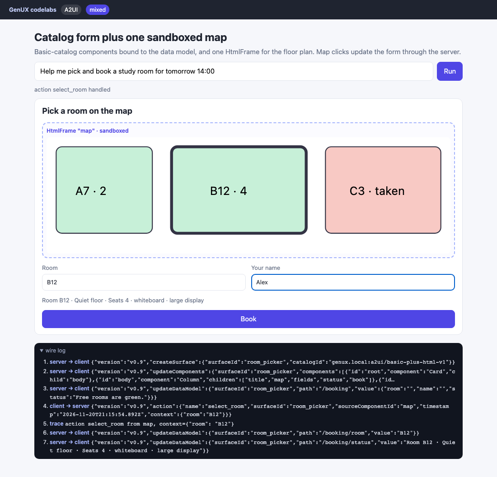
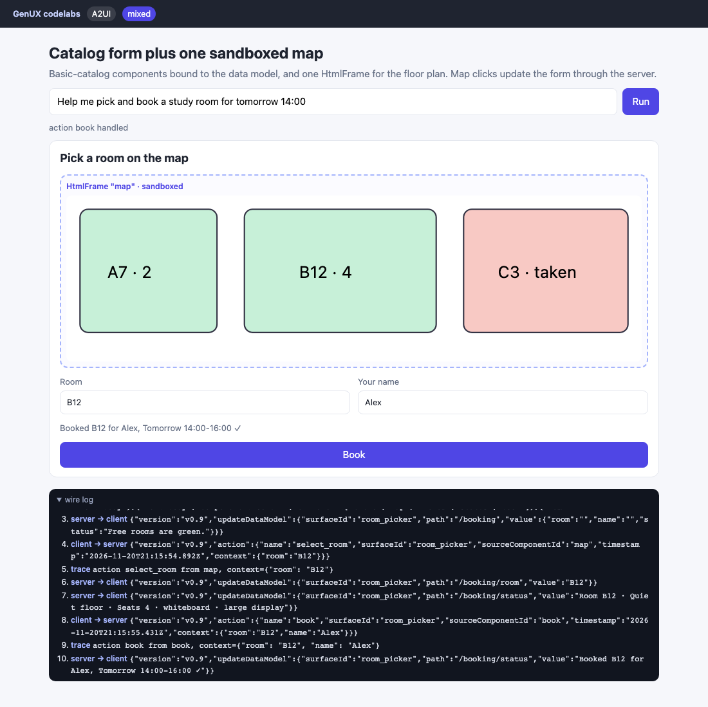

# A2UI · mixed: a catalog form plus one sandboxed map

**Mode: mixed.** The surface uses basic-catalog components for everything a catalog can express: title, inputs, status and button, all bound to the data model. Only the floor plan, which no catalog component can draw, is an `HtmlFrame`. A click on the map becomes an `action`; the server answers with `updateDataModel`, and the catalog `TextField` bound to `/booking/room` updates. Neither action needs a model call.

## Run it

```bash
python 01_a2ui/4_mixed/demo.py
```

## Execution

The demo clicks B12 on the map, types "Alex" and clicks **Book**.

<!-- OUTPUT -->
```text
$ python 01_a2ui/4_mixed/demo.py

POST api/run  {"prompt":"Help me pick and book a study room for tomorrow 14:00"}
  <- createSurface {"surfaceId":"room_picker","catalogId":"genux.local:a2ui/basic-plus-html-v1"}
  <- updateComponents {"surfaceId":"room_picker","components":[{"id":"root","component":"Card","child":"body"},{"id":"body","component":"Column","child…
  <- updateDataModel {"surfaceId":"room_picker","path":"/booking","value":{"room":"","name":"","status":"Free rooms are green."}}
POST api/action  {"version":"v0.9","action":{"name":"select_room","surfaceId":"room_picker","sourceComponentId":"map","timesta…
  <- trace {"text":"action select_room from map, context={\"room\": \"B12\"}"}
  <- updateDataModel {"surfaceId":"room_picker","path":"/booking/room","value":"B12"}
  <- updateDataModel {"surfaceId":"room_picker","path":"/booking/status","value":"Room B12 · Quiet floor · Seats 4 · whiteboard · large display"}
POST api/action  {"version":"v0.9","action":{"name":"book","surfaceId":"room_picker","sourceComponentId":"book","timestamp":"2…
  <- trace {"text":"action book from book, context={\"room\": \"B12\", \"name\": \"Alex\"}"}
  <- updateDataModel {"surfaceId":"room_picker","path":"/booking/status","value":"Booked B12 for Alex, Tomorrow 14:00-16:00 ✓"}

screenshots: demo_before.png, demo.png   (3 request(s), 1.8s)
```
<!-- /OUTPUT -->

| Map click filled the Room field | After "Book" |
|---|---|
|  |  |

## Code walkthrough

### 1. The catalog that allows both

`../a2ui.py` defines `BASIC_PLUS_HTML_CATALOG` as the basic components plus `HtmlFrame`:

```python
    BASIC_PLUS_HTML_CATALOG: {**_BASIC, **_HTML},
```

### 2. The prompt limits the escape hatch

`agent.py` asks for at most one `HtmlFrame`, used only where basic components cannot draw:

```python
Prefer basic components (Text, Row, Column, Card, Button, TextField). Use at most ONE HtmlFrame, only for
```

### 3. One surface, two kinds of component

`agent.py`, the component list the model wrote. The map is one entry among catalog components; the `room` field binds to the path the map's action will update:

```python
    {"id": "map", "component": "HtmlFrame", "html": MAP, "height": 140},
    {"id": "fields", "component": "Row", "children": ["room", "name"]},
    {"id": "room", "component": "TextField", "label": "Room", "value": {"path": "/booking/room"}},
```

### 4. The sandbox drives the data model, through the server

`agent.py` handles both actions with ordinary code. The answer is data only:

```python
    if action["name"] == "select_room" and room and (room["id"], SLOT) not in BOOKED:
        yield a2ui.update_data_model(SURFACE, "/booking/room", room["id"])
        yield a2ui.update_data_model(SURFACE, "/booking/status", f"{room['name']} · {room['details']}")
```

The wire log shows the source: `sourceComponentId: "map"` for the sandbox click and `"book"` for the button.

## What to notice

- The custom region is small and isolated. Everything the user types or reads is a checked catalog component.
- After the first render, the two actions cost two small `updateDataModel` messages and no model tokens.
- A click on the booked room C3 is ignored by the map, and refused by the server if forged.

## Compared with open-ended

Open-ended resent the whole HTML on every change. Here the HTML is sent once; later changes go through the data model, which A2UI was designed for.
