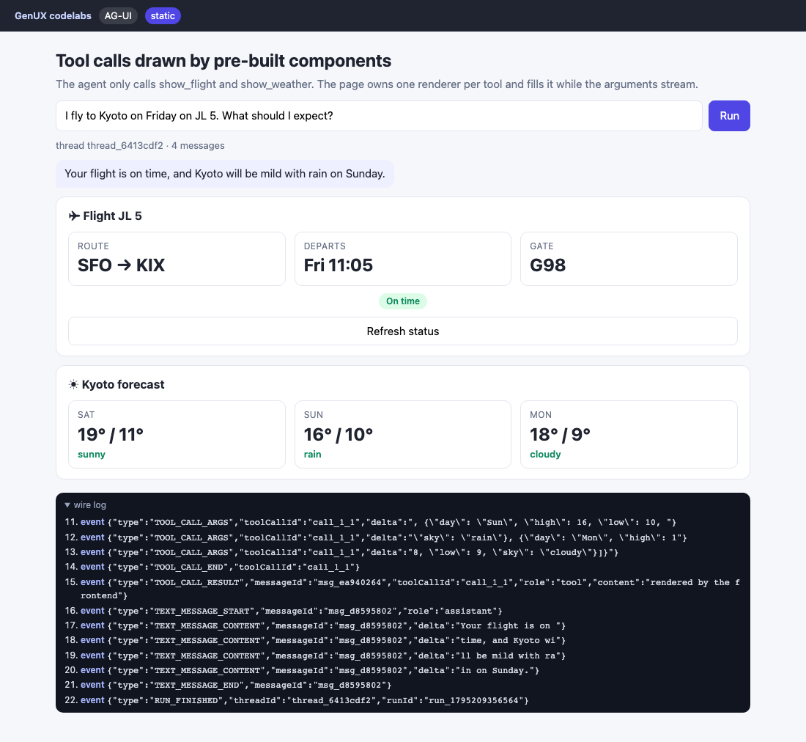
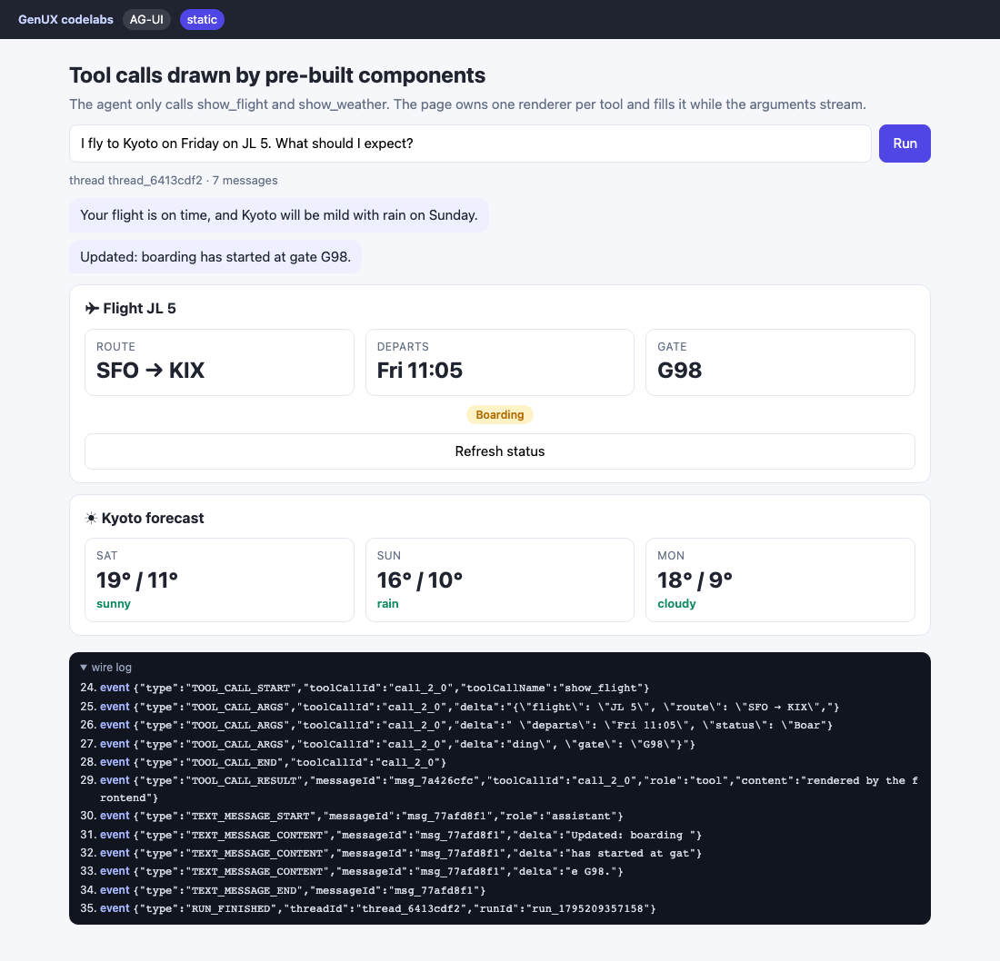

# AG-UI · static: tool calls drawn by pre-built components

**Mode: static.** The agent never describes UI. It calls `show_flight` and `show_weather`. AG-UI carries each call as `TOOL_CALL_START`, several `TOOL_CALL_ARGS` deltas and `TOOL_CALL_END`. The page owns one hand-written component per tool name and fills it while the arguments are still streaming. **Refresh status** starts a second run on the same thread.

## Run it

```bash
python 02_ag_ui/1_static/demo.py
```

## Execution

<!-- OUTPUT -->
```text
$ python 02_ag_ui/1_static/demo.py

POST api/run  {"threadId":"thread_6413cdf2","runId":"run_1795209356564","messages":[{"id":"user_1795209356564","role":"user…
  <- RUN_STARTED {"threadId":"thread_6413cdf2","runId":"run_1795209356564"}
  <- TOOL_CALL_START {"toolCallId":"call_1_0","toolCallName":"show_flight"}
  <- TOOL_CALL_ARGS {"toolCallId":"call_1_0","delta":"{\"flight\": \"JL 5\", \"route\": \"SFO → KIX\","}
  <- TOOL_CALL_ARGS {"toolCallId":"call_1_0","delta":" \"departs\": \"Fri 11:05\", \"status\": \"On t"}
  <- TOOL_CALL_ARGS {"toolCallId":"call_1_0","delta":"ime\", \"gate\": \"G98\"}"}
  <- TOOL_CALL_END {"toolCallId":"call_1_0"}
  <- TOOL_CALL_RESULT {"messageId":"msg_52edc495","toolCallId":"call_1_0","role":"tool","content":"rendered by the frontend"}
  <- TOOL_CALL_START {"toolCallId":"call_1_1","toolCallName":"show_weather"}
  <- TOOL_CALL_ARGS x5  (first: {"toolCallId":"call_1_1","delta":"{\"city\": \"Kyoto\", \"days\": [{\")
  <- TOOL_CALL_END {"toolCallId":"call_1_1"}
  <- TOOL_CALL_RESULT {"messageId":"msg_ea940264","toolCallId":"call_1_1","role":"tool","content":"rendered by the frontend"}
  <- TEXT_MESSAGE_START {"messageId":"msg_d8595802","role":"assistant"}
  <- TEXT_MESSAGE_CONTENT x4  (first: {"messageId":"msg_d8595802","delta":"Your flight is on "})
  <- TEXT_MESSAGE_END {"messageId":"msg_d8595802"}
  <- RUN_FINISHED {"threadId":"thread_6413cdf2","runId":"run_1795209356564"}
POST api/run  {"threadId":"thread_6413cdf2","runId":"run_1795209357158","messages":[{"id":"user_1795209356564","role":"user…
  <- RUN_STARTED {"threadId":"thread_6413cdf2","runId":"run_1795209357158"}
  <- TOOL_CALL_START {"toolCallId":"call_2_0","toolCallName":"show_flight"}
  <- TOOL_CALL_ARGS {"toolCallId":"call_2_0","delta":"{\"flight\": \"JL 5\", \"route\": \"SFO → KIX\","}
  <- TOOL_CALL_ARGS {"toolCallId":"call_2_0","delta":" \"departs\": \"Fri 11:05\", \"status\": \"Boar"}
  <- TOOL_CALL_ARGS {"toolCallId":"call_2_0","delta":"ding\", \"gate\": \"G98\"}"}
  <- TOOL_CALL_END {"toolCallId":"call_2_0"}
  <- TOOL_CALL_RESULT {"messageId":"msg_7a426cfc","toolCallId":"call_2_0","role":"tool","content":"rendered by the frontend"}
  <- TEXT_MESSAGE_START {"messageId":"msg_77afd8f1","role":"assistant"}
  <- TEXT_MESSAGE_CONTENT {"messageId":"msg_77afd8f1","delta":"Updated: boarding "}
  <- TEXT_MESSAGE_CONTENT {"messageId":"msg_77afd8f1","delta":"has started at gat"}
  <- TEXT_MESSAGE_CONTENT {"messageId":"msg_77afd8f1","delta":"e G98."}
  <- TEXT_MESSAGE_END {"messageId":"msg_77afd8f1"}
  <- RUN_FINISHED {"threadId":"thread_6413cdf2","runId":"run_1795209357158"}

browser console:
  [genux] rendered show_flight from 100 streamed chars
  [genux] rendered show_weather from 191 streamed chars
  [genux] rendered show_flight from 101 streamed chars

screenshots: demo_before.png, demo.png   (2 request(s), 1.7s)
```
<!-- /OUTPUT -->

| First run | After "Refresh status" (second run, same thread) |
|---|---|
|  |  |

## Code walkthrough

### 1. Tools are the whole UI vocabulary

`agent.py` declares two function-calling tools. Their names are the only "components" the model knows:

```python
TOOLS = [
    tool("show_flight", "Show the flight card", {"flight": {"type": "string"}, "route": {"type": "string"},
```

### 2. Every tool call becomes a stream of events

`agent.py` turns the model's tool calls into AG-UI events and rejects anything the page cannot draw:

```python
    for call in reply["tool_calls"]:
        if call["name"] not in {"show_flight", "show_weather"}:
            yield agui.run_error(f"unknown tool {call['name']}")
            return
        yield from agui.tool_call(call["name"], call["arguments"], call["id"])
        yield agui.tool_result(call["id"], "rendered by the frontend")
```

### 3. The page's registry: tool name → component

`app.js` maps each tool to a renderer built from catalog pieces. `??` placeholders let a half-received argument object render:

```js
  const renderers = {
    show_flight: (a) => c("Card", { title: `✈ Flight ${a.flight ?? "…"}` }, [
```

### 4. Partial JSON makes streaming visible

`app.js` re-renders on every `TOOL_CALL_ARGS` with whatever has arrived. `partialJSON` in `../agui.mjs` closes open strings and brackets so a prefix parses:

```js
    const args = partialJSON(callInfo.raw) || {};
```

`../agui.mjs`, the trick inside `partialJSON`:

```js
  let candidate = text + (inString ? '"' : "");
```

### 5. A follow-up is another run

The button's handler sends a new user message. `../client.mjs` posts the whole thread again, so the agent sees the history:

```js
  const send = async (messages) => {
    page.status("running…");
    await session.run(messages);
```

## What to notice

- The flight card is replaced, not duplicated: the page keeps one slot per tool name.
- The second run's `TOOL_CALL_ARGS` carry `"status": "Boarding"`, and the badge turns amber.
- The protocol never mentions UI. AG-UI only moved a tool call; the page decided what it looks like.
