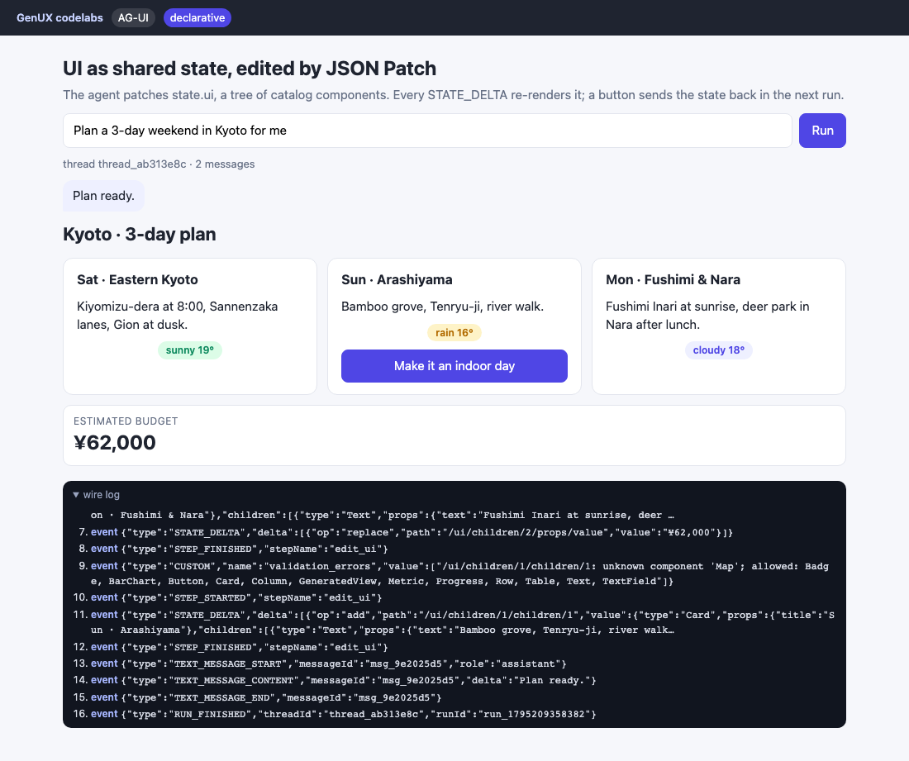
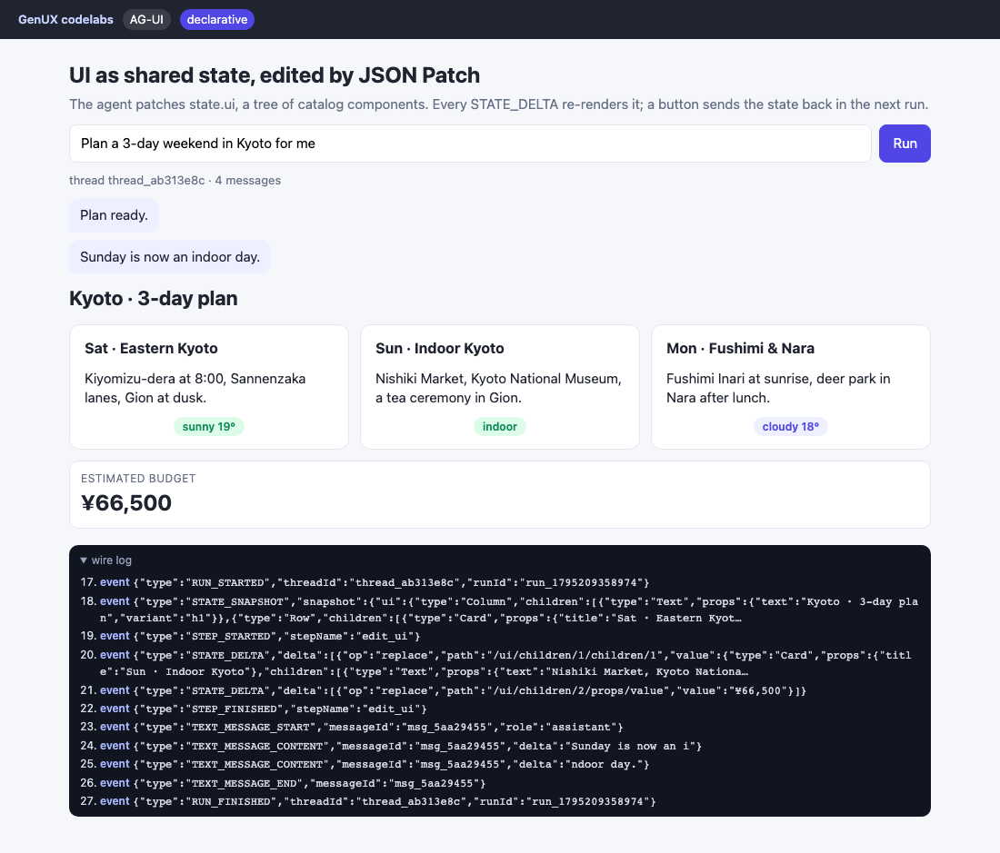

# AG-UI · declarative: the UI lives in shared state

**Mode: declarative.** The agent and the page share a state document. `state.ui` holds a tree of catalog components. The model writes RFC 6902 JSON Patch operations against it; the server applies each one to a copy, validates the whole tree, and only then emits it as a `STATE_DELTA`. The page re-renders the tree after every delta. A button starts a new run that carries the current state back.

## Run it

```bash
python 02_ag_ui/2_declarative/demo.py
```

## Execution

The model's first batch contained a `Map` component that is not in the catalog. The server rejected that operation, reported it in a `CUSTOM` event, and the model sent the missing day. Then the demo clicks **Make it an indoor day**.

<!-- OUTPUT -->
```text
$ python 02_ag_ui/2_declarative/demo.py

POST api/run  {"threadId":"thread_ab313e8c","runId":"run_1795209358382","messages":[{"id":"user_1795209358382","role":"user…
  <- RUN_STARTED {"threadId":"thread_ab313e8c","runId":"run_1795209358382"}
  <- STATE_SNAPSHOT {"snapshot":{"ui":{"type":"Column","children":[{"type":"Text","props":{"text":"Kyoto · 3-day plan","variant":"h1"}},{"type":"Row"…
  <- STEP_STARTED {"stepName":"edit_ui"}
  <- STATE_DELTA x4  (first: {"delta":[{"op":"add","path":"/ui","value":{"type":"Column","children")
  <- STEP_FINISHED {"stepName":"edit_ui"}
  <- CUSTOM {"name":"validation_errors","value":["/ui/children/1/children/1: unknown component 'Map'; allowed: Badge, BarChart, Button, Card,…
  <- STEP_STARTED {"stepName":"edit_ui"}
  <- STATE_DELTA {"delta":[{"op":"add","path":"/ui/children/1/children/1","value":{"type":"Card","props":{"title":"Sun · Arashiyama"},"children":[…
  <- STEP_FINISHED {"stepName":"edit_ui"}
  <- TEXT_MESSAGE_START {"messageId":"msg_9e2025d5","role":"assistant"}
  <- TEXT_MESSAGE_CONTENT {"messageId":"msg_9e2025d5","delta":"Plan ready."}
  <- TEXT_MESSAGE_END {"messageId":"msg_9e2025d5"}
  <- RUN_FINISHED {"threadId":"thread_ab313e8c","runId":"run_1795209358382"}
POST api/run  {"threadId":"thread_ab313e8c","runId":"run_1795209358974","messages":[{"id":"user_1795209358382","role":"user…
  <- RUN_STARTED {"threadId":"thread_ab313e8c","runId":"run_1795209358974"}
  <- STATE_SNAPSHOT {"snapshot":{"ui":{"type":"Column","children":[{"type":"Text","props":{"text":"Kyoto · 3-day plan","variant":"h1"}},{"type":"Row"…
  <- STEP_STARTED {"stepName":"edit_ui"}
  <- STATE_DELTA {"delta":[{"op":"replace","path":"/ui/children/1/children/1","value":{"type":"Card","props":{"title":"Sun · Indoor Kyoto"},"child…
  <- STATE_DELTA {"delta":[{"op":"replace","path":"/ui/children/2/props/value","value":"¥66,500"}]}
  <- STEP_FINISHED {"stepName":"edit_ui"}
  <- TEXT_MESSAGE_START {"messageId":"msg_5aa29455","role":"assistant"}
  <- TEXT_MESSAGE_CONTENT {"messageId":"msg_5aa29455","delta":"Sunday is now an i"}
  <- TEXT_MESSAGE_CONTENT {"messageId":"msg_5aa29455","delta":"ndoor day."}
  <- TEXT_MESSAGE_END {"messageId":"msg_5aa29455"}
  <- RUN_FINISHED {"threadId":"thread_ab313e8c","runId":"run_1795209358974"}

browser console:
  [genux] server rejected: /ui/children/1/children/1: unknown component 'Map'; allowed: Badge, BarChart, Button, Card, Column, GeneratedView, Metric, Progress, Row, Table, Text, TextField

screenshots: demo_before.png, demo.png   (2 request(s), 1.8s)
```
<!-- /OUTPUT -->

| The plan, built by patches | After the rain plan |
|---|---|
|  |  |

## Code walkthrough

### 1. Apply, validate, then emit

`agent.py` never forwards an operation that would break the tree:

```python
        problems = validate_tree(candidate.get("ui"))
        if problems:
            errors.extend(problems)
            continue
        state.clear()
        state.update(candidate)
        yield agui.state_delta([op])
```

### 2. The validator walks the tree

`../ui_tree.py` checks every node against the shared catalog, and checks the HTML of a `GeneratedView` against the content policy:

```python
    errors = [f"{path}: {e}" for e in validate_props(node["type"], node.get("props", {}), allowed)]
```

### 3. Rejections are visible and recoverable

`agent.py` reports the rejected operations as a `CUSTOM` event and gives the model one more try:

```python
        yield agui.custom("validation_errors", errors)
        messages.append({"role": "user", "content": "These operations were rejected: " + "; ".join(errors)})
```

### 4. The frontend holds the state

`agent.py` starts from the state the page sent in `RunAgentInput`, so the second run patches exactly what the user sees:

```python
    state = run["state"]                        # the frontend sends the state it holds
```

### 5. The page is three lines of logic

`app.js` renders the tree on every state change and turns a button into a new run:

```js
  session.onState = (state) => canvas.replaceChildren(renderTree(state.ui, ctx));
```

## What to notice

- The dashboard grows one `STATE_DELTA` at a time inside `STEP_STARTED` / `STEP_FINISHED`.
- The rain plan is two operations: replace one card, update one metric.
- The state is the contract. Any frontend that renders the catalog can join the thread.

## Compared with static

Static had a fixed component per tool. Here the model composes the layout, so the server validates a whole tree before each delta.
