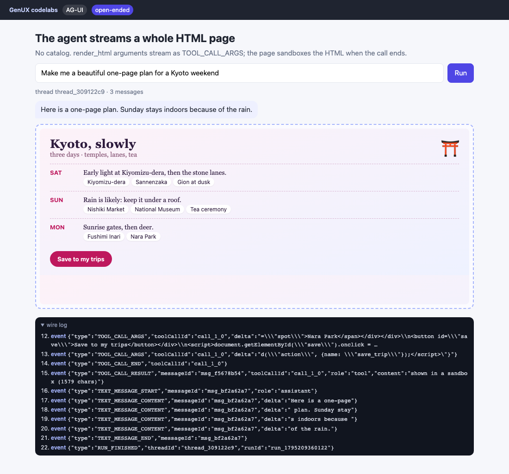
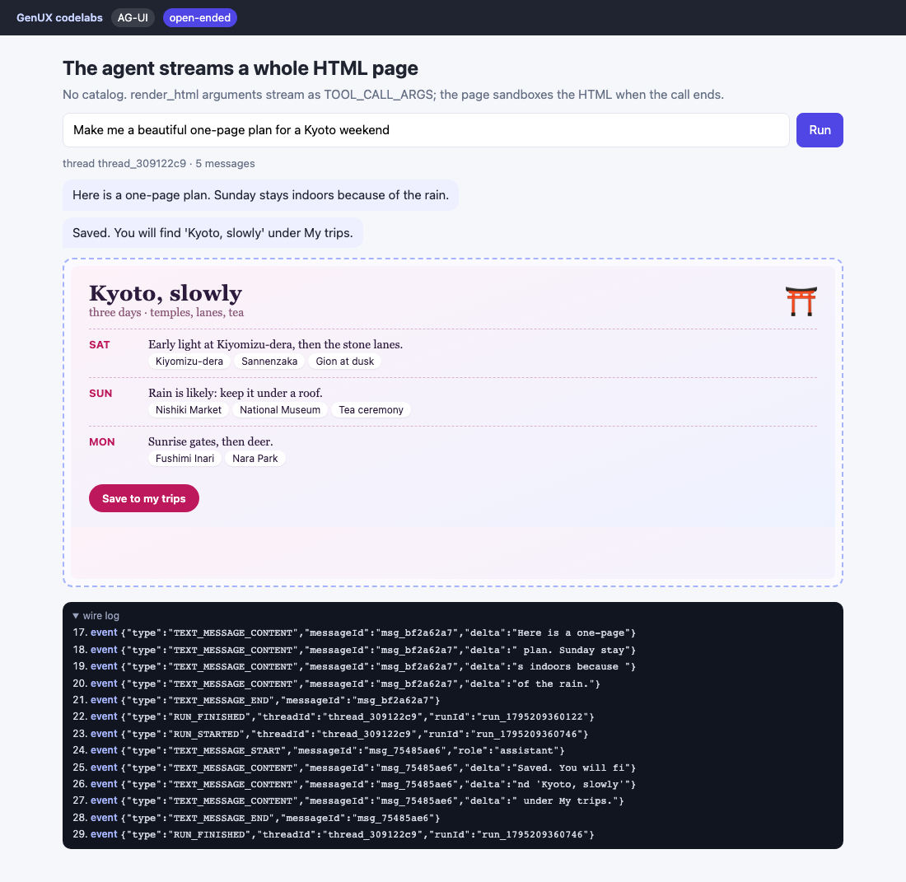

# AG-UI · open-ended: the agent streams a whole HTML page

**Mode: open-ended.** There is no catalog. The model calls `render_html` with a complete page. The server checks the HTML against the content policy *before* it streams the arguments, because once `TOOL_CALL_ARGS` leave the server they cannot be taken back. The page shows the progress, then mounts the HTML in a sandboxed iframe on `TOOL_CALL_END`. A button inside the frame starts the next run.

## Run it

```bash
python 02_ag_ui/3_open_ended/demo.py
```

## Execution

The demo clicks **Save to my trips** inside the sandbox. The HTML arrives as 11 `TOOL_CALL_ARGS` deltas.

<!-- OUTPUT -->
```text
$ python 02_ag_ui/3_open_ended/demo.py

POST api/run  {"threadId":"thread_309122c9","runId":"run_1795209360122","messages":[{"id":"user_1795209360122","role":"user…
  <- RUN_STARTED {"threadId":"thread_309122c9","runId":"run_1795209360122"}
  <- TOOL_CALL_START {"toolCallId":"call_1_0","toolCallName":"render_html"}
  <- TOOL_CALL_ARGS x11  (first: {"toolCallId":"call_1_0","delta":"{\"html\": \"<style>\\n body{backgro)
  <- TOOL_CALL_END {"toolCallId":"call_1_0"}
  <- TOOL_CALL_RESULT {"messageId":"msg_f5678b54","toolCallId":"call_1_0","role":"tool","content":"shown in a sandbox (1579 chars)"}
  <- TEXT_MESSAGE_START {"messageId":"msg_bf2a62a7","role":"assistant"}
  <- TEXT_MESSAGE_CONTENT x4  (first: {"messageId":"msg_bf2a62a7","delta":"Here is a one-page"})
  <- TEXT_MESSAGE_END {"messageId":"msg_bf2a62a7"}
  <- RUN_FINISHED {"threadId":"thread_309122c9","runId":"run_1795209360122"}
POST api/run  {"threadId":"thread_309122c9","runId":"run_1795209360746","messages":[{"id":"user_1795209360122","role":"user…
  <- RUN_STARTED {"threadId":"thread_309122c9","runId":"run_1795209360746"}
  <- TEXT_MESSAGE_START {"messageId":"msg_75485ae6","role":"assistant"}
  <- TEXT_MESSAGE_CONTENT {"messageId":"msg_75485ae6","delta":"Saved. You will fi"}
  <- TEXT_MESSAGE_CONTENT {"messageId":"msg_75485ae6","delta":"nd 'Kyoto, slowly'"}
  <- TEXT_MESSAGE_CONTENT {"messageId":"msg_75485ae6","delta":" under My trips."}
  <- TEXT_MESSAGE_END {"messageId":"msg_75485ae6"}
  <- RUN_FINISHED {"threadId":"thread_309122c9","runId":"run_1795209360746"}

browser console:
  [genux] mounted 1579 chars of model HTML in a sandbox

screenshots: demo_before.png, demo.png   (2 request(s), 1.8s)
```
<!-- /OUTPUT -->

| The generated page | After "Save to my trips" |
|---|---|
|  |  |

## Code walkthrough

### 1. One tool, no vocabulary

`agent.py` gives the model a single tool. Its description is the whole contract:

```python
TOOLS = [tool("render_html", "Show a self-contained HTML page to the user. No external URLs. "
```

### 2. Check first, stream second

`agent.py` refuses the call with `RUN_ERROR` if the HTML breaks the policy. Only clean HTML is streamed:

```python
        problems = check_html(html)                     # check before anything is streamed
        if call["name"] != "render_html" or problems:
            yield agui.run_error(f"refused render_html: {'; '.join(problems) or 'unknown tool'}")
            return
        yield from agui.tool_call("render_html", {"html": html}, call["id"], chunk=160)
```

### 3. Show progress, mount at the end

`app.js` counts characters while the arguments stream and mounts the sandbox when the call ends:

```js
    if (phase === "args") progress.textContent = `receiving HTML… ${callInfo.raw.length} chars`;
```

### 4. The frame's only exit

`app.js` turns an allowed sandbox message into a user message on the same thread:

```js
          if (type === "action") send([{ id: `user_${Date.now()}`, role: "user", content: `[action] ${payload.name}` }]);
```

## What to notice

- The look is entirely the model's: fonts, gradient, layout.
- Nothing appears until the last delta, because half an HTML document is not safe to run.
- The protocol is unchanged from the static mode: the same tool-call events carry a much larger payload.

## Compared with declarative

Declarative validated a component tree before each delta. Here the only check is the content policy on the server and the sandbox in the browser.
