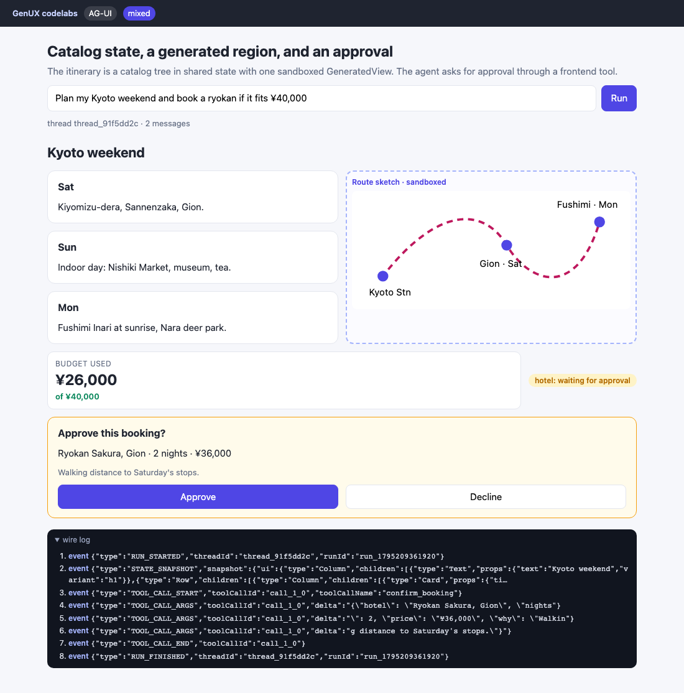
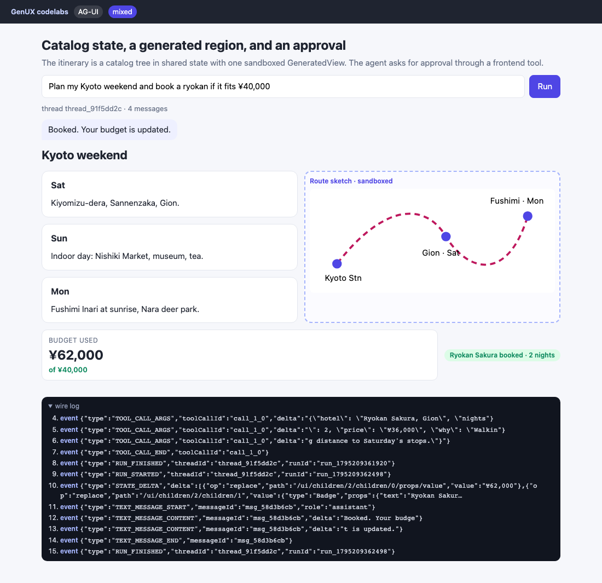

# AG-UI · mixed: catalog state, one generated region, a human in the loop

**Mode: mixed.** Three AG-UI features work together:

* The itinerary is a catalog tree in `state.ui` (declarative, validated).
* One node is a `GeneratedView` with model-written HTML for the route sketch (open-ended, one region only, sandboxed).
* The agent asks for approval through `confirm_booking`, a tool the **frontend** declared in `RunAgentInput.tools`. The run ends; the page draws the approval card; the answer returns as a `tool` message in the next run.

## Run it

```bash
python 02_ag_ui/4_mixed/demo.py
```

## Execution

The demo clicks **Approve**. The second run patches the budget and the hotel badge.

<!-- OUTPUT -->
```text
$ python 02_ag_ui/4_mixed/demo.py

POST api/run  {"threadId":"thread_91f5dd2c","runId":"run_1795209361920","messages":[{"id":"user_1795209361920","role":"user…
  <- RUN_STARTED {"threadId":"thread_91f5dd2c","runId":"run_1795209361920"}
  <- STATE_SNAPSHOT {"snapshot":{"ui":{"type":"Column","children":[{"type":"Text","props":{"text":"Kyoto weekend","variant":"h1"}},{"type":"Row","chi…
  <- TOOL_CALL_START {"toolCallId":"call_1_0","toolCallName":"confirm_booking"}
  <- TOOL_CALL_ARGS {"toolCallId":"call_1_0","delta":"{\"hotel\": \"Ryokan Sakura, Gion\", \"nights"}
  <- TOOL_CALL_ARGS {"toolCallId":"call_1_0","delta":"\": 2, \"price\": \"¥36,000\", \"why\": \"Walkin"}
  <- TOOL_CALL_ARGS {"toolCallId":"call_1_0","delta":"g distance to Saturday's stops.\"}"}
  <- TOOL_CALL_END {"toolCallId":"call_1_0"}
  <- RUN_FINISHED {"threadId":"thread_91f5dd2c","runId":"run_1795209361920"}
POST api/run  {"threadId":"thread_91f5dd2c","runId":"run_1795209362498","messages":[{"id":"user_1795209361920","role":"user…
  <- RUN_STARTED {"threadId":"thread_91f5dd2c","runId":"run_1795209362498"}
  <- STATE_DELTA {"delta":[{"op":"replace","path":"/ui/children/2/children/0/props/value","value":"¥62,000"},{"op":"replace","path":"/ui/children/…
  <- TEXT_MESSAGE_START {"messageId":"msg_58d3b6cb","role":"assistant"}
  <- TEXT_MESSAGE_CONTENT {"messageId":"msg_58d3b6cb","delta":"Booked. Your budge"}
  <- TEXT_MESSAGE_CONTENT {"messageId":"msg_58d3b6cb","delta":"t is updated."}
  <- TEXT_MESSAGE_END {"messageId":"msg_58d3b6cb"}
  <- RUN_FINISHED {"threadId":"thread_91f5dd2c","runId":"run_1795209362498"}

browser console:
  [genux] frontend tool confirm_booking is waiting for the user

screenshots: demo_before.png, demo.png   (2 request(s), 1.8s)
```
<!-- /OUTPUT -->

| Waiting for approval | After "Approve" |
|---|---|
|  |  |

## Code walkthrough

### 1. The frontend declares a tool

`app.js` adds `confirm_booking` to the session. It is sent with every run:

```js
  session.tools = [{ name: "confirm_booking", description: "Ask the user to approve a hotel booking",
```

### 2. The agent may only call tools the frontend offered

`agent.py` checks the call against `RunAgentInput.tools`, streams it, and ends the run. The frontend owns the next move:

```python
    declared = {t["name"] for t in run["tools"]}
    for call in reply["tool_calls"]:
        if call["name"] not in declared:                     # only tools the frontend offered
            yield agui.run_error(f"{call['name']} was not declared by the frontend")
            return
```

### 3. The user's answer is a tool message

`app.js` sends the answer with the same `toolCallId`. `../agui.mjs` has already recorded the assistant's tool call in the history:

```js
      send([{ id: `tool_${Date.now()}`, role: "tool", toolCallId: callInfo.id, content: JSON.stringify({ approved }) }]);
```

### 4. The next run continues from the answer

`agent.py` recognises the tool message and patches the shared state, validating the result as usual:

```python
    if last.get("role") == "tool":                         # the user answered the approval card
        answer = json.loads(last["content"])
```

### 5. One generated region inside a checked tree

The route sketch is an ordinary node in `agent.py`. The tree validator runs the content policy on its HTML:

```python
        {"type": "GeneratedView", "props": {"title": "Route sketch", "html": ROUTE, "height": 190}}]},
```

## What to notice

- The first run ends with `RUN_FINISHED` right after `TOOL_CALL_END`: the agent waits without holding a connection open.
- Declining sends `{"approved": false}`; the agent patches the badge to "no hotel booked".
- Only the route sketch is free-form. The money and the decision are catalog components.

## Compared with open-ended

Open-ended handed the whole screen to the model. Here the model's HTML is one sandboxed node, and the parts that matter are validated state and an explicit approval.
