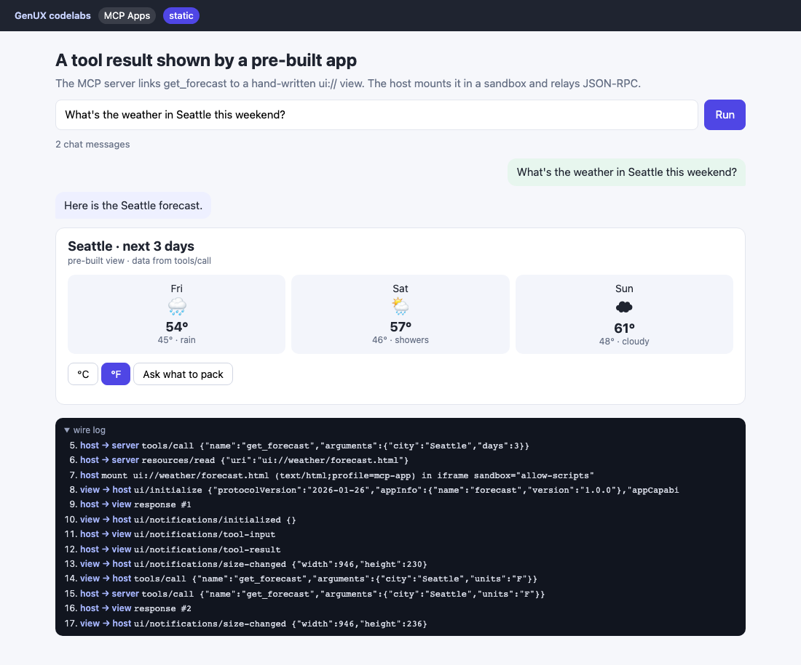
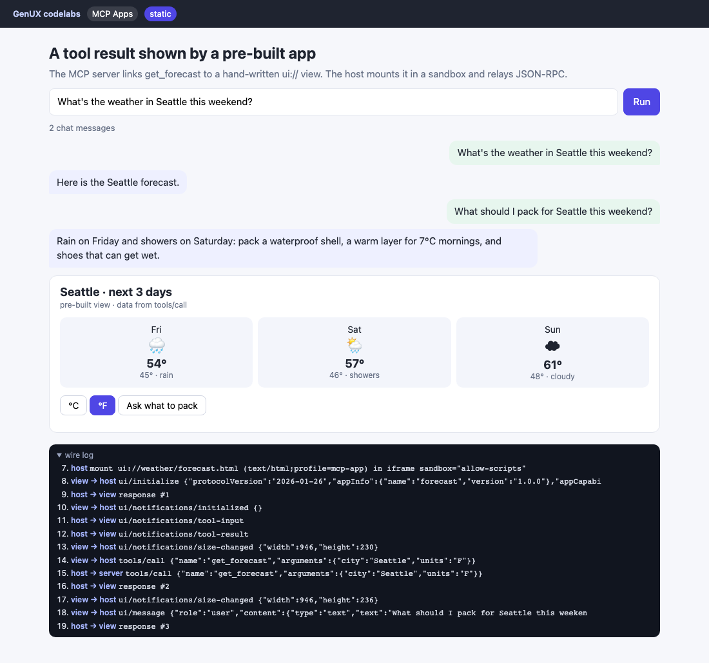

# MCP Apps · static: a tool result shown by a pre-built app

**Mode: static.** The MCP server has one tool, `get_forecast`, linked by `_meta.ui.resourceUri` to `ui://weather/forecast.html`, a view written by hand. The tool returns text for the model and `structuredContent` for the view. The host's model only chooses the tool and its arguments.

## Run it

```bash
python 03_mcp_apps/1_static/demo.py
```

## Execution

The demo clicks **°F** inside the app (a `tools/call` through the host), takes a screenshot, then clicks **Ask what to pack** (a `ui/message` that adds a chat turn). `POST api/mcp` lines are host ↔ server; the browser console lines are app ↔ host.

<!-- OUTPUT -->
```text
$ python 03_mcp_apps/1_static/demo.py

POST api/mcp  initialize  {"protocolVersion":"2025-06-18","clientInfo":{"name":"genux-host"},"capabilities":{"extensions":{"io.modelcon…
  <- {"jsonrpc":"2.0","id":1,"result":{"protocolVersion":"2025-06-18","serverInfo":{"name":"weather-static","version":"1.0.0"},"capabilities":{"tools":{},…
POST api/mcp  notifications/initialized  {}
  <- {}
POST api/mcp  tools/list  {}
  <- {"jsonrpc":"2.0","id":2,"result":{"tools":[{"name":"get_forecast","description":"Forecast for a city (Seattle or San Jose).","inputSchema":{"type":"o…
POST api/chat  {"messages":[{"role":"user","content":"What's the weather in Seattle this weekend?"}],"tools":["get_forecast"…
  <- {"text":"Here is the Seattle forecast.","toolCall":{"name":"get_forecast","arguments":{"city":"Seattle","days":3}}}
POST api/mcp  tools/call  {"name":"get_forecast","arguments":{"city":"Seattle","days":3}}
  <- {"jsonrpc":"2.0","id":3,"result":{"content":[{"type":"text","text":"Seattle: Fri 12°C/7°C rain; Sat 14°C/8°C showers; Sun 16°C/9°C cloudy"}],"structu…
POST api/mcp  resources/read  {"uri":"ui://weather/forecast.html"}
  <- {"jsonrpc":"2.0","id":4,"result":{"contents":[{"uri":"ui://weather/forecast.html","mimeType":"text/html;profile=mcp-app","text":"<!doctype html>\n<ht…
POST api/mcp  tools/call  {"name":"get_forecast","arguments":{"city":"Seattle","units":"F"}}
  <- {"jsonrpc":"2.0","id":5,"result":{"content":[{"type":"text","text":"Seattle: Fri 54°F/45°F rain; Sat 57°F/46°F showers; Sun 61°F/48°F cloudy"}],"stru…
POST api/chat  {"messages":[{"role":"user","content":"What's the weather in Seattle this weekend?"},{"role":"assistant","con…
  <- {"text":"Rain on Friday and showers on Saturday: pack a waterproof shell, a warm layer for 7°C mornings, and shoes that can get wet.","toolCall":null}

browser console:
  [genux] host         mount ui://weather/forecast.html (text/html;profile=mcp-app) in iframe sandbox="allow-scripts"
  [genux] view → host  ui/initialize {"protocolVersion":"2026-01-26","appInfo":{"name":"forecast","version":"1.0.0"},"appCapabi
  [genux] host → view  response #1
  [genux] view → host  ui/notifications/initialized {}
  [genux] host → view  ui/notifications/tool-input
  [genux] host → view  ui/notifications/tool-result
  [genux] view → host  ui/notifications/size-changed {"width":946,"height":230}
  [genux] view → host  tools/call {"name":"get_forecast","arguments":{"city":"Seattle","units":"F"}}
  [genux] host → view  response #2
  [genux] view → host  ui/notifications/size-changed {"width":946,"height":236}
  [genux] view → host  ui/message {"role":"user","content":{"type":"text","text":"What should I pack for Seattle this weeken
  [genux] host → view  response #3

screenshots: demo_before.png, demo.png   (8 request(s), 2.4s)
```
<!-- /OUTPUT -->

| The app after switching to °F | After "Ask what to pack" |
|---|---|
|  |  |

## Code walkthrough

### 1. A tool, a resource, and the link between them

`agent.py`:

```python
server.tool("get_forecast", "Forecast for a city (Seattle or San Jose).",
            {"properties": {"city": {"type": "string"}, "days": {"type": "integer"}, "units": {"enum": ["C", "F"]}},
             "required": ["city"]}, get_forecast, ui=VIEW)
server.resource(VIEW, "forecast_view", lambda: views.build(HERE / "forecast.html"))
```

### 2. Two audiences in one result

`agent.py` returns text any host can show, and structured data for the app:

```python
    return result(weather.as_text(city, rows, units), {"city": city, "units": units, "days": rows})
```

### 3. The view waits for data

`forecast.html` is static HTML. Its data arrives later as a notification from the host:

```html
  mcpApp.on("ui/notifications/tool-result", render);
  const units = (u) => mcpApp.callTool("get_forecast", { city: current.city, units: u }).then(render);
```

### 4. The host decides what the app may do

`../host.mjs` delivers the tool input and result after the app's handshake, and proxies the app's tool calls only to tools this server listed:

```js
        case "ui/notifications/initialized":
          toView({ jsonrpc: "2.0", method: "ui/notifications/tool-input", params: { arguments: args } });
          toView({ jsonrpc: "2.0", method: "ui/notifications/tool-result", params: result });
```

### 5. The app can speak in the chat

`forecast.html` asks the host to add a user message; the host runs its model again:

```html
  document.getElementById("ask").onclick = () => mcpApp.say(`What should I pack for ${current.city} this weekend?`);
```

## What to notice

- A host without MCP Apps support still shows the tool's text: the UI is a progressive enhancement.
- The °F switch never touched the model. The app called the tool through the host.
- The bridge is ordinary JSON-RPC: requests with ids, responses, and notifications.
