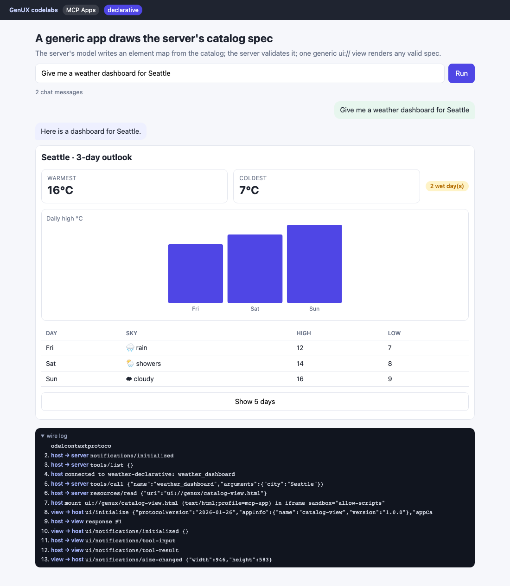
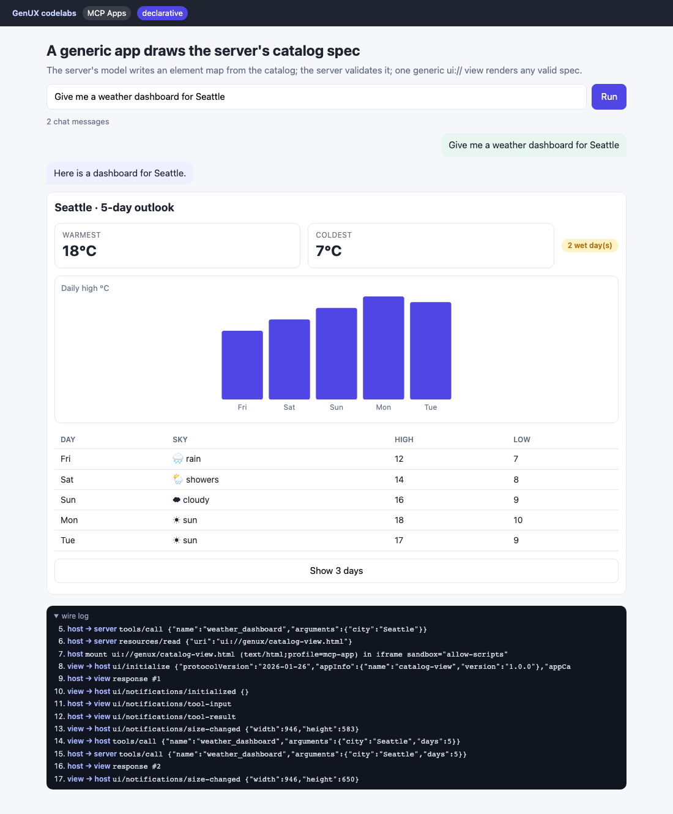

# MCP Apps · declarative: a generic app draws the server's catalog spec

**Mode: declarative.** `weather_dashboard` asks a server-side model for a dashboard as a flat element map built from the shared catalog. The server validates it, including that every button names an action the server defined, and returns it as `structuredContent`. The app, `ui://genux/catalog-view.html`, contains no weather code: it renders any valid spec.

## Run it

```bash
python 03_mcp_apps/2_declarative/demo.py
```

## Execution

The demo clicks **Show 5 days** inside the app.

<!-- OUTPUT -->
```text
$ python 03_mcp_apps/2_declarative/demo.py

POST api/mcp  initialize  {"protocolVersion":"2025-06-18","clientInfo":{"name":"genux-host"},"capabilities":{"extensions":{"io.modelcon…
  <- {"jsonrpc":"2.0","id":1,"result":{"protocolVersion":"2025-06-18","serverInfo":{"name":"weather-declarative","version":"1.0.0"},"capabilities":{"tools…
POST api/mcp  notifications/initialized  {}
  <- {}
POST api/mcp  tools/list  {}
  <- {"jsonrpc":"2.0","id":2,"result":{"tools":[{"name":"weather_dashboard","description":"A weather dashboard for a city (Seattle or San Jose).","inputSc…
POST api/chat  {"messages":[{"role":"user","content":"Give me a weather dashboard for Seattle"}],"tools":["weather_dashboard…
  <- {"text":"Here is a dashboard for Seattle.","toolCall":{"name":"weather_dashboard","arguments":{"city":"Seattle"}}}
POST api/mcp  tools/call  {"name":"weather_dashboard","arguments":{"city":"Seattle"}}
  <- {"jsonrpc":"2.0","id":3,"result":{"content":[{"type":"text","text":"Seattle: Fri 12°C/7°C rain; Sat 14°C/8°C showers; Sun 16°C/9°C cloudy"}],"structu…
POST api/mcp  resources/read  {"uri":"ui://genux/catalog-view.html"}
  <- {"jsonrpc":"2.0","id":4,"result":{"contents":[{"uri":"ui://genux/catalog-view.html","mimeType":"text/html;profile=mcp-app","text":"<!doctype html>\n<…
POST api/mcp  tools/call  {"name":"weather_dashboard","arguments":{"city":"Seattle","days":5}}
  <- {"jsonrpc":"2.0","id":5,"result":{"content":[{"type":"text","text":"Seattle: Fri 12°C/7°C rain; Sat 14°C/8°C showers; Sun 16°C/9°C cloudy; Mon 18°C/1…

browser console:
  [genux] host         mount ui://genux/catalog-view.html (text/html;profile=mcp-app) in iframe sandbox="allow-scripts"
  [genux] view → host  ui/initialize {"protocolVersion":"2026-01-26","appInfo":{"name":"catalog-view","version":"1.0.0"},"appCa
  [genux] host → view  response #1
  [genux] view → host  ui/notifications/initialized {}
  [genux] host → view  ui/notifications/tool-input
  [genux] host → view  ui/notifications/tool-result
  [genux] view → host  ui/notifications/size-changed {"width":946,"height":583}
  [genux] view → host  tools/call {"name":"weather_dashboard","arguments":{"city":"Seattle","days":5}}
  [genux] host → view  response #2
  [genux] view → host  ui/notifications/size-changed {"width":946,"height":650}

screenshots: demo_before.png, demo.png   (7 request(s), 2.4s)
```
<!-- /OUTPUT -->

| 3-day dashboard | After "Show 5 days" |
|---|---|
|  |  |

## Code walkthrough

### 1. The server's model writes the spec

`agent.py` passes the forecast and the allowed action names to the model, then validates what comes back:

```python
    spec = json.loads(reply["content"])
    errors = validate_element_map(spec)
    errors += [f"unknown action {el['props']['action']!r}" for el in spec["elements"].values()
               if el["type"] == "Button" and el["props"]["action"] not in actions]
```

### 2. Actions are server-defined

`agent.py`: the model may only *name* an action. The mapping from name to tool call is the server's:

```python
    actions = {f"show_{n}_days": {"tool": "weather_dashboard", "arguments": {"city": city, "days": n}} for n in (3, 5)}
```

### 3. One view for any spec

`../views.py` inlines the shared catalog renderers into the resource, so the app is self-contained:

```python
    if with_catalog:  # the shared catalog renderers, so the view can draw a spec
```

`../catalog-view.html` draws the spec and turns a button into the mapped tool call:

```html
    onAction(name) {
      const target = actions[name];
      if (target) mcpApp.callTool(target.tool, target.arguments).then(render);
    },
```

### 4. The shared validator

`../../shared/spec.py` checks a flat element map against the catalog, including missing children:

```python
        if complete:
            errors += [f"{eid}: child {k!r} is missing" for k in kids if k not in elements]
```

## What to notice

- The same `catalog-view.html` serves this codelab and the mixed one. It is reusable because it knows nothing about weather.
- An invalid spec becomes a tool result with `isError: true`, which the host's model can read and retry.
- A button cannot call an arbitrary tool: it can only name an action the server put in the result.

## Compared with static

Static shipped a hand-written view. Here the server's model designs the screen, and the view is a renderer.
