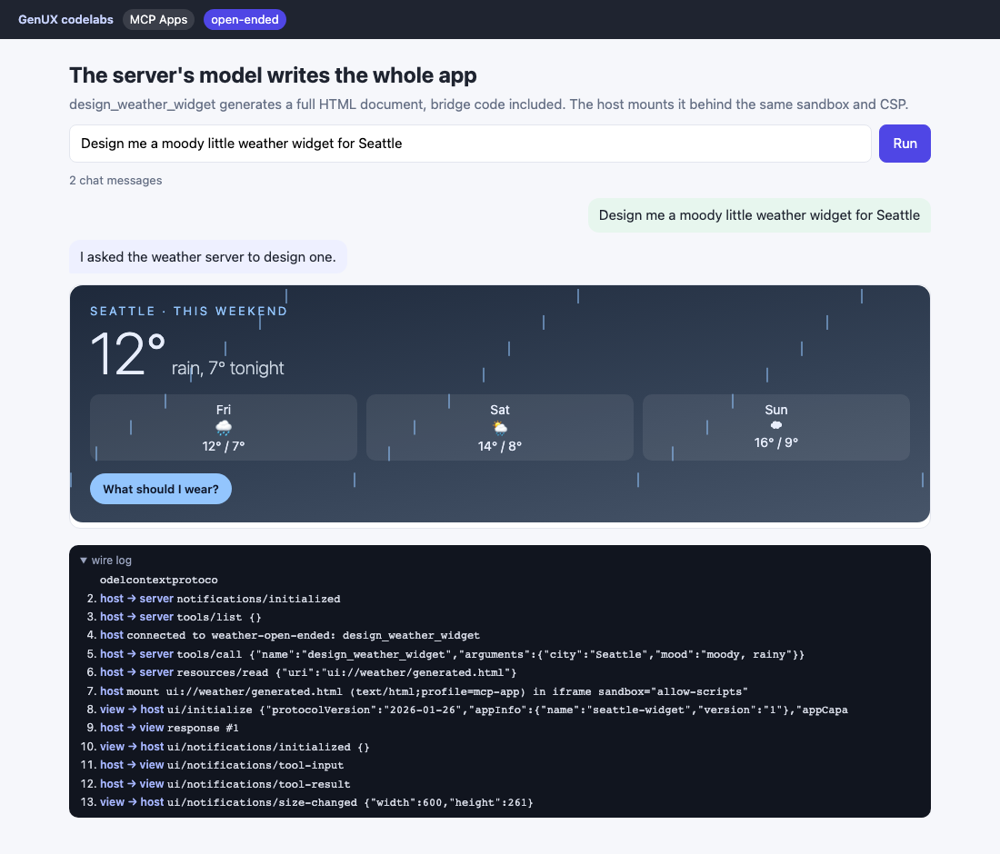
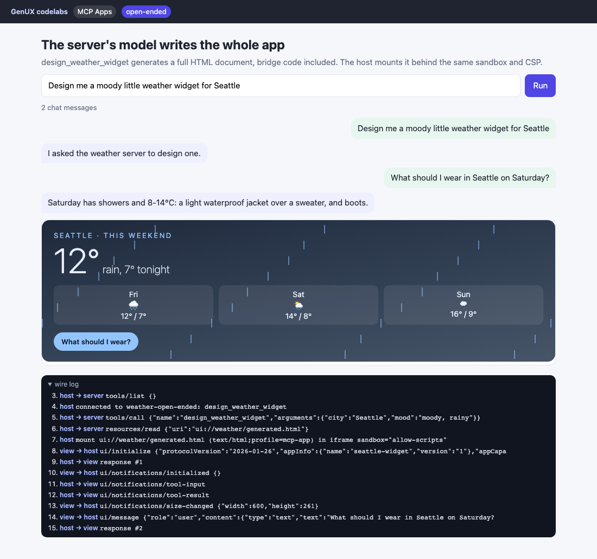

# MCP Apps · open-ended: the server's model writes the whole app

**Mode: open-ended.** `design_weather_widget` asks the server-side model for a complete HTML document, including its own JSON-RPC bridge code. The server checks it against the content policy, retries once with the errors, and stores it as the content of `ui://weather/generated.html`. The host reads that resource and mounts it like any other app, behind the same sandbox and CSP.

## Run it

```bash
python 03_mcp_apps/3_open_ended/demo.py
```

## Execution

The model's first document linked a web font from a CDN; the policy refused it, and the tool result reports two attempts. The demo then clicks **What should I wear?** inside the generated app.

<!-- OUTPUT -->
```text
$ python 03_mcp_apps/3_open_ended/demo.py

POST api/mcp  initialize  {"protocolVersion":"2025-06-18","clientInfo":{"name":"genux-host"},"capabilities":{"extensions":{"io.modelcon…
  <- {"jsonrpc":"2.0","id":1,"result":{"protocolVersion":"2025-06-18","serverInfo":{"name":"weather-open-ended","version":"1.0.0"},"capabilities":{"tools"…
POST api/mcp  notifications/initialized  {}
  <- {}
POST api/mcp  tools/list  {}
  <- {"jsonrpc":"2.0","id":2,"result":{"tools":[{"name":"design_weather_widget","description":"Design a custom weather widget for a city.","inputSchema":{…
POST api/chat  {"messages":[{"role":"user","content":"Design me a moody little weather widget for Seattle"}],"tools":["desig…
  <- {"text":"I asked the weather server to design one.","toolCall":{"name":"design_weather_widget","arguments":{"city":"Seattle","mood":"moody, rainy"}}}
POST api/mcp  tools/call  {"name":"design_weather_widget","arguments":{"city":"Seattle","mood":"moody, rainy"}}
  <- {"jsonrpc":"2.0","id":3,"result":{"content":[{"type":"text","text":"Generated a 2277-character widget for Seattle."}],"structuredContent":{"attempts"…
POST api/mcp  resources/read  {"uri":"ui://weather/generated.html"}
  <- {"jsonrpc":"2.0","id":4,"result":{"contents":[{"uri":"ui://weather/generated.html","mimeType":"text/html;profile=mcp-app","text":"<!doctype html>\n<h…
POST api/chat  {"messages":[{"role":"user","content":"Design me a moody little weather widget for Seattle"},{"role":"assista…
  <- {"text":"Saturday has showers and 8-14°C: a light waterproof jacket over a sweater, and boots.","toolCall":null}

browser console:
  [genux] host         mount ui://weather/generated.html (text/html;profile=mcp-app) in iframe sandbox="allow-scripts"
  [genux] view → host  ui/initialize {"protocolVersion":"2026-01-26","appInfo":{"name":"seattle-widget","version":"1"},"appCapa
  [genux] host → view  response #1
  [genux] view → host  ui/notifications/initialized {}
  [genux] host → view  ui/notifications/tool-input
  [genux] host → view  ui/notifications/tool-result
  [genux] view → host  ui/notifications/size-changed {"width":600,"height":261}
  [genux] view → host  ui/message {"role":"user","content":{"type":"text","text":"What should I wear in Seattle on Saturday?
  [genux] host → view  response #2

screenshots: demo_before.png, demo.png   (7 request(s), 2.1s)
```
<!-- /OUTPUT -->

| The generated widget | After "What should I wear?" |
|---|---|
|  |  |

## Code walkthrough

### 1. Generate, check, retry

`agent.py`:

```python
    for attempt in range(2):
        html = STATE["model"].complete(messages)["content"]
        problems = check_html(html)
        if not problems:
            STATE["html"] = html                       # becomes the ui:// resource's content
```

### 2. The generated HTML becomes the resource

`agent.py` serves whatever the last successful generation produced:

```python
server.resource(VIEW, "generated_widget", lambda: STATE["html"])
```

### 3. The model writes the bridge itself

The generated document has no shared helper; the model wrote the JSON-RPC calls (in `agent.py`, as the scripted reply):

```python
 rpc("ui/initialize", {protocolVersion: "2026-01-26", appInfo: {name: "seattle-widget", version: "1"}, appCapabilities: {}});
```

### 4. Same host, same rules

`../host.mjs` treats generated and hand-written apps the same way: the CSP comes from the resource metadata, and the frame has an opaque origin.

```js
export function cspFor(meta) {
```

## What to notice

- The widget's look (rain animation, dark gradient) is beyond any catalog.
- The model had to write protocol code. A mistake there breaks the app, not the host.
- Hosts may prefetch `ui://` resources. A per-call generated resource works with this host, but a static resource plus data is more portable.

## Compared with declarative

Declarative sent data into a fixed renderer. Here the renderer itself is generated, so the checks move to the content policy and the host's sandbox.
