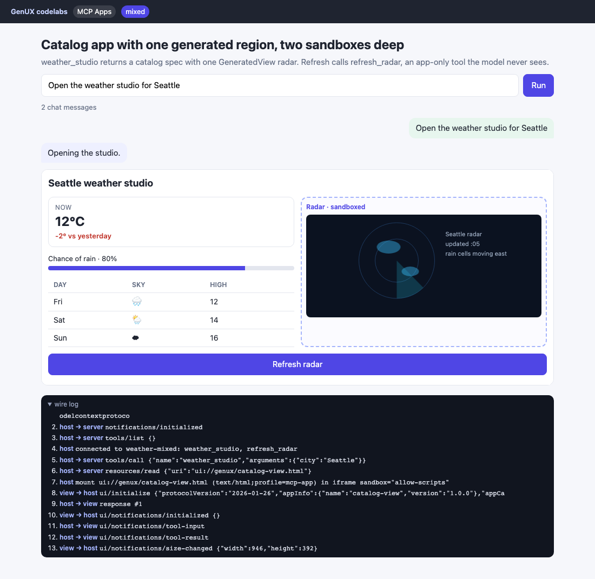
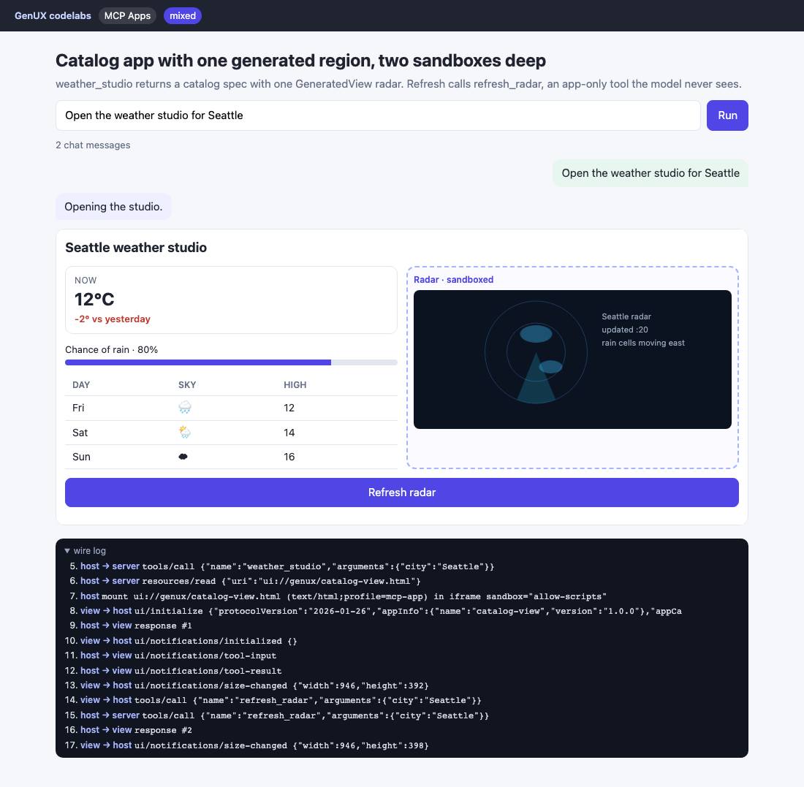

# MCP Apps · mixed: a catalog app with one generated region, two sandboxes deep

**Mode: mixed.** `weather_studio` returns a catalog element map. One element is a `GeneratedView` with model-written HTML for an animated radar. The app renders the catalog and puts that region in a *nested* sandboxed iframe, inside the host's sandbox. **Refresh radar** calls `refresh_radar`, an app-only tool: the app may call it through the host, but the host never offers it to the model.

## Run it

```bash
python 03_mcp_apps/4_mixed/demo.py
```

## Execution

The demo clicks **Refresh radar** inside the app. The radar's timestamp changes from :05 to :20.

<!-- OUTPUT -->
```text
$ python 03_mcp_apps/4_mixed/demo.py

POST api/mcp  initialize  {"protocolVersion":"2025-06-18","clientInfo":{"name":"genux-host"},"capabilities":{"extensions":{"io.modelcon…
  <- {"jsonrpc":"2.0","id":1,"result":{"protocolVersion":"2025-06-18","serverInfo":{"name":"weather-mixed","version":"1.0.0"},"capabilities":{"tools":{},"…
POST api/mcp  notifications/initialized  {}
  <- {}
POST api/mcp  tools/list  {}
  <- {"jsonrpc":"2.0","id":2,"result":{"tools":[{"name":"weather_studio","description":"Open an interactive weather studio for a city.","inputSchema":{"ty…
POST api/chat  {"messages":[{"role":"user","content":"Open the weather studio for Seattle"}],"tools":["weather_studio"]}
  <- {"text":"Opening the studio.","toolCall":{"name":"weather_studio","arguments":{"city":"Seattle"}}}
POST api/mcp  tools/call  {"name":"weather_studio","arguments":{"city":"Seattle"}}
  <- {"jsonrpc":"2.0","id":3,"result":{"content":[{"type":"text","text":"Weather studio for Seattle: 12°C now, 80% chance of rain."}],"structuredContent":…
POST api/mcp  resources/read  {"uri":"ui://genux/catalog-view.html"}
  <- {"jsonrpc":"2.0","id":4,"result":{"contents":[{"uri":"ui://genux/catalog-view.html","mimeType":"text/html;profile=mcp-app","text":"<!doctype html>\n<…
POST api/mcp  tools/call  {"name":"refresh_radar","arguments":{"city":"Seattle"}}
  <- {"jsonrpc":"2.0","id":5,"result":{"content":[{"type":"text","text":"Weather studio for Seattle: 12°C now, 80% chance of rain."}],"structuredContent":…

browser console:
  [genux] host         mount ui://genux/catalog-view.html (text/html;profile=mcp-app) in iframe sandbox="allow-scripts"
  [genux] view → host  ui/initialize {"protocolVersion":"2026-01-26","appInfo":{"name":"catalog-view","version":"1.0.0"},"appCa
  [genux] host → view  response #1
  [genux] view → host  ui/notifications/initialized {}
  [genux] host → view  ui/notifications/tool-input
  [genux] host → view  ui/notifications/tool-result
  [genux] view → host  ui/notifications/size-changed {"width":946,"height":392}
  [genux] view → host  tools/call {"name":"refresh_radar","arguments":{"city":"Seattle"}}
  [genux] host → view  response #2
  [genux] view → host  ui/notifications/size-changed {"width":946,"height":398}

screenshots: demo_before.png, demo.png   (7 request(s), 2.3s)
```
<!-- /OUTPUT -->

| The studio | After "Refresh radar" |
|---|---|
|  |  |

## Code walkthrough

### 1. An app-only tool

`agent.py` registers `refresh_radar` with `app_only=True`, which sets `_meta.ui.visibility` to `["app"]`:

```python
server.tool("refresh_radar", "Re-draw the radar region. Called by the app, not the model.",
            {"properties": {"city": {"type": "string"}}, "required": ["city"]},
            lambda city: _studio(city, "Refresh the radar"), app_only=True)
```

### 2. The host filters what the model sees

`../host.mjs` removes app-only tools before calling its model:

```js
    const modelTools = tools.filter((t) => !(t._meta?.ui?.visibility || ["model"]).every((v) => v === "app"));
```

`agent.py` asserts it on the server side of the demo:

```python
    assert "refresh_radar" not in body["tools"], "the host must not offer app-only tools to the model"
```

### 3. At most one generated region

`agent.py` validates the catalog spec and limits the escape hatch:

```python
    if sum(e["type"] == "GeneratedView" for e in spec["elements"].values()) > 1:
        errors.append("at most one GeneratedView")
```

### 4. Two boundaries

The host's iframe isolates the app from the host. Inside it, `GeneratedView` mounts the radar with the shared sandbox, so the generated HTML is isolated from the app too. `../../shared/js/catalog.mjs`:

```js
    mountSandbox(box, p.html, { height: p.height || 220, onMessage: ctx.onSandboxMessage });
```

## What to notice

- The numbers (temperature, rain chance, table) are catalog components the server validated.
- The free-form part is one region, and it cannot reach the app's bridge or the host.
- The model can open the studio, but only the user, through the app, can refresh the radar.

## Compared with open-ended

Open-ended let the model write the whole app, bridge included. Here the bridge and layout are fixed, and the model's HTML fills one isolated region.
