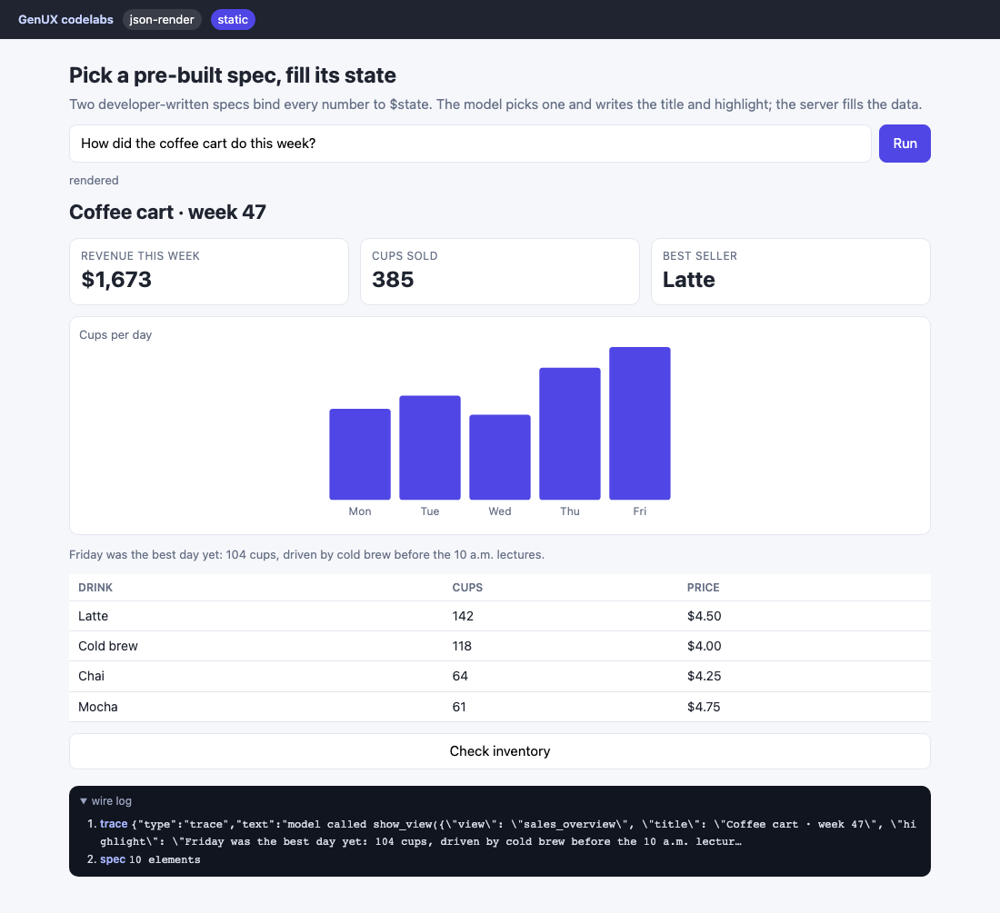
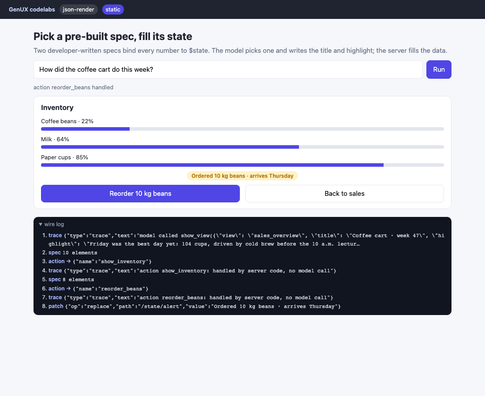

# json-render · static: pick a pre-built spec, fill its state

**Mode: static.** `specs/sales_overview.json` and `specs/inventory.json` are written by a developer. Every number in them is a `$state` binding. The model calls `show_view` with a view name, a title and one highlight sentence. The server fills `state` from the cart's own data, checks that every binding resolves, and sends the finished spec. Buttons are handled by plain server code: the registry already has the next screen.

## Run it

```bash
python 04_json_render/1_static/demo.py
```

## Execution

The demo clicks **Check inventory**, then **Reorder 10 kg beans**. The second action is a single state patch.

<!-- OUTPUT -->
```text
$ python 04_json_render/1_static/demo.py

POST api/run  {"prompt":"How did the coffee cart do this week?"}
  <- trace {"text":"model called show_view({\"view\": \"sales_overview\", \"title\": \"Coffee cart · week 47\", \"highlight\": \"Friday was …
  <- spec {"spec":{"root":"page","elements":{"page":{"type":"Column","children":["title","kpis","chart","highlight","items","inventory"]},"…
POST api/action  {"name":"show_inventory","context":{},"spec":{"root":"page","elements":{"page":{"type":"Column","children":["…
  <- trace {"text":"action show_inventory: handled by server code, no model call"}
  <- spec {"spec":{"root":"page","elements":{"page":{"type":"Card","props":{"title":"Inventory"},"children":["beans","milk","cups","alert",…
POST api/action  {"name":"reorder_beans","context":{},"spec":{"root":"page","elements":{"page":{"type":"Card","props":{"title"…
  <- trace {"text":"action reorder_beans: handled by server code, no model call"}
  <- patch {"op":{"op":"replace","path":"/state/alert","value":"Ordered 10 kg beans · arrives Thursday"}}

screenshots: demo_before.png, demo.png   (3 request(s), 1.7s)
```
<!-- /OUTPUT -->

| Sales overview | Inventory after the reorder |
|---|---|
|  |  |

## Code walkthrough

### 1. The registry

`agent.py` loads every developer-written spec into a dict, and the tool's `view` argument is an enum of its keys:

```python
REGISTRY = {p.stem: json.loads(p.read_text()) for p in sorted((HERE / "specs").glob("*.json"))}
```

### 2. Words from the model, numbers from the app

`../cart.py` builds the state. The model supplies `title` and `highlight`; the rest is the cart's data:

```python
def sales_state(title: str, highlight: str) -> dict:
    return {"title": title, "highlight": highlight, "revenue": f"${REVENUE:,.0f}", "cups": sum(CUPS),
```

### 3. Every binding must resolve

`agent.py` refuses to send a spec whose bindings point at nothing:

```python
    spec = {**json.loads(json.dumps(REGISTRY[view])), "state": state}
    errors = jsonrender.validate(spec)
```

### 4. A state change is one patch

`agent.py` answers the reorder action without touching the layout:

```python
        yield {"type": "patch", "op": {"op": "replace", "path": "/state/alert", "value": "Ordered 10 kg beans · arrives Thursday"}}
```

## What to notice

- The model's whole contribution is about 40 tokens.
- No action calls the model. The registry is the UI, and the app owns the data.
- Changing the inventory alert redraws one badge because it is bound to `/state/alert`.
