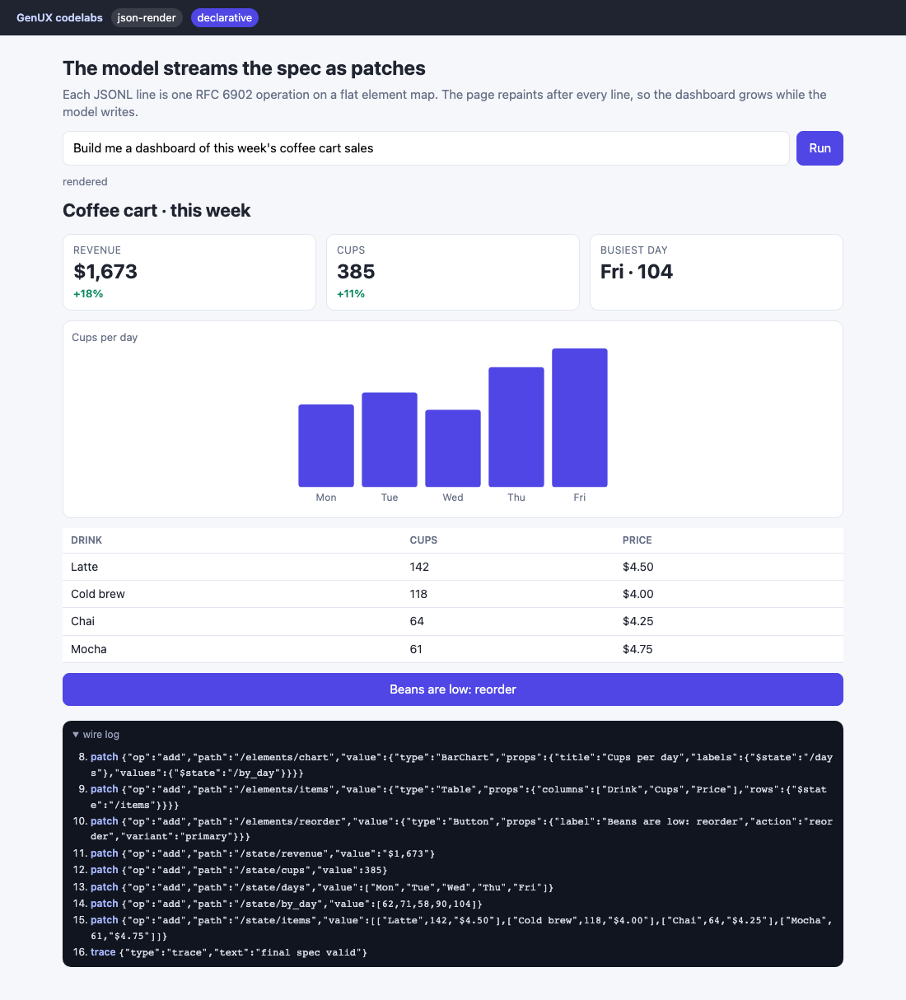
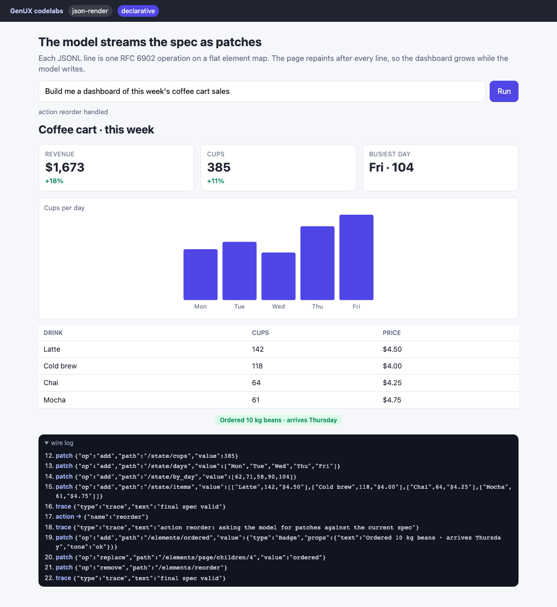

# json-render · declarative: the model streams the spec as patches

**Mode: declarative.** The model writes JSONL: one RFC 6902 operation per line against an empty spec `{root, elements, state}`. The server applies each line, validates the partial spec, and forwards the operation at once. The page applies the same operation and repaints, so the first components appear while the model is still writing. A button sends the current spec back; the model answers with more patches.

## Run it

```bash
python 04_json_render/2_declarative/demo.py
```

## Execution

The scripted model streams at a fixed simulated speed. The browser console shows first paint after 3 patches; the note at the end compares how much the model must write before anything can be drawn.

<!-- OUTPUT -->
```text
$ python 04_json_render/2_declarative/demo.py

POST api/run  {"prompt":"Build me a dashboard of this week's coffee cart sales"}
  <- patch x15  (first: {"op":{"op":"add","path":"/root","value":"page"},"t":0.032})
  <- trace {"text":"final spec valid"}
POST api/action  {"name":"reorder","context":{},"spec":{"root":"page","elements":{"page":{"type":"Column","children":["title",…
  <- trace {"text":"action reorder: asking the model for patches against the current spec"}
  <- patch {"op":{"op":"add","path":"/elements/ordered","value":{"type":"Badge","props":{"text":"Ordered 10 kg beans · arrives Thursday","to…
  <- patch {"op":{"op":"replace","path":"/elements/page/children/4","value":"ordered"},"t":0.173}
  <- patch {"op":{"op":"remove","path":"/elements/reorder"},"t":0.208}
  <- trace {"text":"final spec valid"}

browser console:
  [genux] first paint after 3 patches (231 ms since page load)
  [genux] dashboard complete after 15 patches (1218 ms since page load)

bytes the model must write before the first component can be drawn:
  flat element map, JSONL patches    308 of 1733 (18%)
  one nested JSON tree              1733 of 1733 (100%: it parses only when complete)

screenshots: demo_before.png, demo.png   (2 request(s), 3.1s)
```
<!-- /OUTPUT -->

| The streamed dashboard | After "Beans are low: reorder" |
|---|---|
|  |  |

## Code walkthrough

### 1. Order matters

`agent.py` tells the model to send `/root` first and parents before children:

```python
          "Send /root first, then parents before children, then state. Bind data with {\"$state\": \"/x\"}. "
```

### 2. Apply, validate, forward

`agent.py` keeps a partial spec and forwards only lines that leave it valid. `complete=False` allows children that have not arrived yet:

```python
            errors = jsonrender.validate(candidate, complete=False)
            if errors:
                yield {"type": "trace", "text": "rejected: " + "; ".join(errors)}
                continue
            spec = candidate
            yield {"type": "patch", "op": json.loads(line), "t": round(time.perf_counter() - started, 3)}
```

### 3. Placeholders make partial specs paintable

`../../shared/js/catalog.mjs` renders a missing child as "…" instead of failing:

```js
    if (!element || seen.has(id)) return el("div", "c-placeholder", "…");
```

### 4. An action edits the spec on screen

`agent.py` sends the page's current spec to the model, which answers with three operations: add a badge, point the page at it, remove the button:

```python
    json.dumps({"op": "replace", "path": "/elements/page/children/4", "value": "ordered"}),
    json.dumps({"op": "remove", "path": "/elements/reorder"}),
```

## What to notice

- The title and layout appear after 3 lines; the numbers fill in when the `/state/...` lines arrive.
- A nested JSON tree would parse only when complete. The flat map paints at 18% of the bytes.
- The reorder response is 3 small patches, not a new dashboard.

## Compared with static

Static sent one finished spec from a registry. Here the model composes it, and streaming makes the cost of composing visible but bearable.
