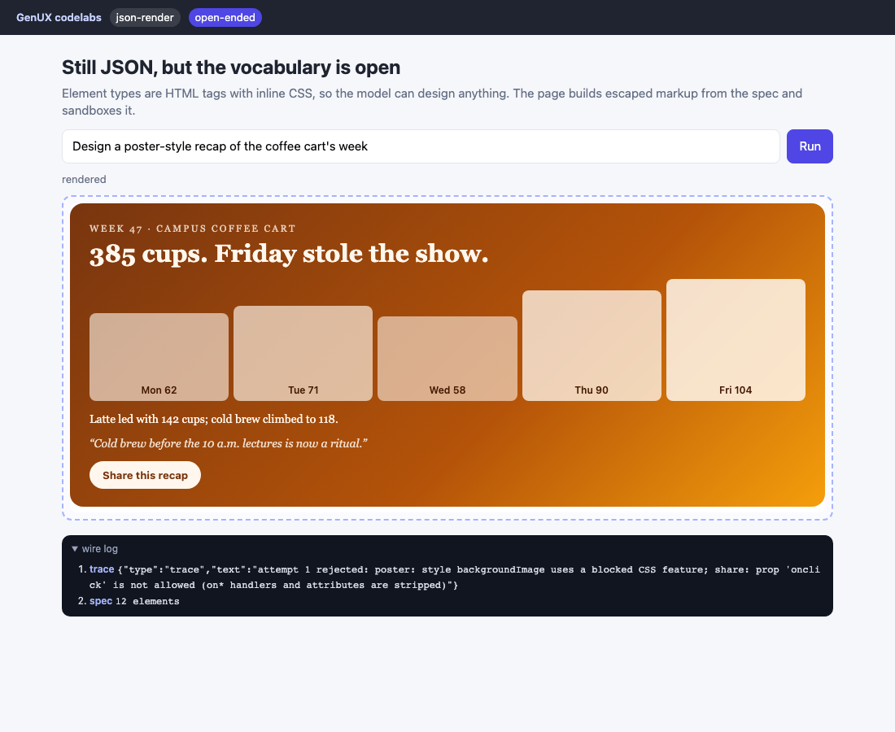
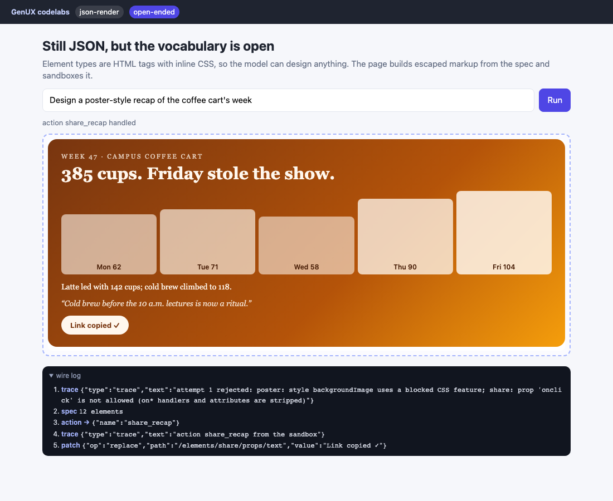

# json-render · open-ended: still JSON, but the vocabulary is open

**Mode: open-ended.** There is no catalog. Element types are HTML tags (`section`, `div`, `h1`, `button`, ...) and props carry inline CSS, so the model can design a poster that no catalog component describes. The structure is still constrained: only safe tags, only the props `style`, `text`, `action` and `label`, and no CSS that loads resources. The page builds the markup itself, escaping all text, and shows it in a sandbox.

## Run it

```bash
python 04_json_render/3_open_ended/demo.py
```

## Execution

The model's first spec had an `onclick` prop and a CSS `url(...)`. Both were refused. The demo then clicks **Share this recap** inside the sandbox.

<!-- OUTPUT -->
```text
$ python 04_json_render/3_open_ended/demo.py

POST api/run  {"prompt":"Design a poster-style recap of the coffee cart's week"}
  <- trace {"text":"attempt 1 rejected: poster: style backgroundImage uses a blocked CSS feature; share: prop 'onclick' is not allowed (on* …
  <- spec {"spec":{"root":"poster","elements":{"poster":{"type":"section","props":{"style":{"background":"linear-gradient(135deg,#78350f,#b…
POST api/action  {"name":"share_recap","context":{},"spec":{"root":"poster","elements":{"poster":{"type":"section","props":{"s…
  <- trace {"text":"action share_recap from the sandbox"}
  <- patch {"op":{"op":"replace","path":"/elements/share/props/text","value":"Link copied ✓"}}

model output size for one screen (tokens, estimated):
  static (show_view arguments)        42
  declarative (catalog patches)      433
  open-ended (HTML-tag spec)         704

screenshots: demo_before.png, demo.png   (2 request(s), 1.7s)
```
<!-- /OUTPUT -->

| The model's poster | After "Share this recap" |
|---|---|
|  |  |

## Code walkthrough

### 1. An open vocabulary with closed structure

`../jsonrender.py`:

```python
OPEN_TAGS = {"div", "span", "p", "h1", "h2", "h3", "strong", "em", "small", "ul", "li", "button", "section"}
OPEN_PROPS = {"style", "text", "action", "label"}
```

```python
        errors += [f"{eid}: prop {k!r} is not allowed (on* handlers and attributes are stripped)"
                   for k in props if k not in OPEN_PROPS]
```

### 2. The builder, not the model, writes markup

`../open-html.mjs` escapes text and attributes, and turns `action` props into one fixed click handler:

```js
const esc = (s) => String(s).replace(/[&<>"']/g, (c) => `&#${c.charCodeAt(0)};`);
```

```js
    n.addEventListener("click", () => genux.send("action", { name: n.dataset.action })));<\/script>`;
```

### 3. Mount in the sandbox

`app.js` replaces the default renderer with the builder plus the shared sandbox:

```js
    mountSandbox(box, buildHtml(spec), { height: 380, onMessage: ctx.onSandboxMessage });
```

### 4. Patches still work

`agent.py` answers the action with a patch on the open spec, the same mechanism as the catalog modes:

```python
        yield {"type": "patch", "op": {"op": "replace", "path": "/elements/share/props/text", "value": "Link copied ✓"}}
```

## What to notice

- "Open-ended" does not have to mean raw HTML. Here the model has full visual freedom, but no way to write a script or an event handler.
- The poster costs about 700 tokens, against about 430 for the catalog dashboard and 40 for the static view.
- The heat strip's bar heights are inline CSS computed by the model from the data.
