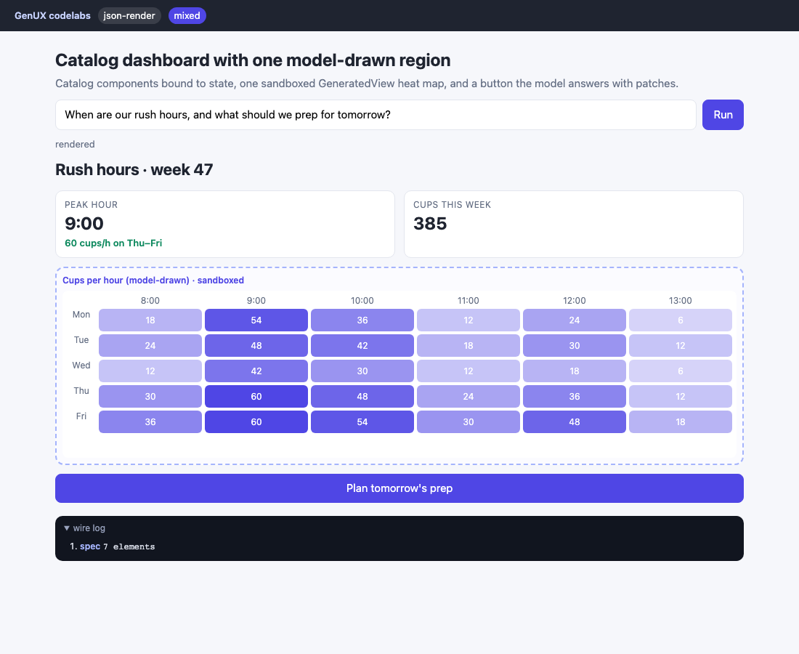
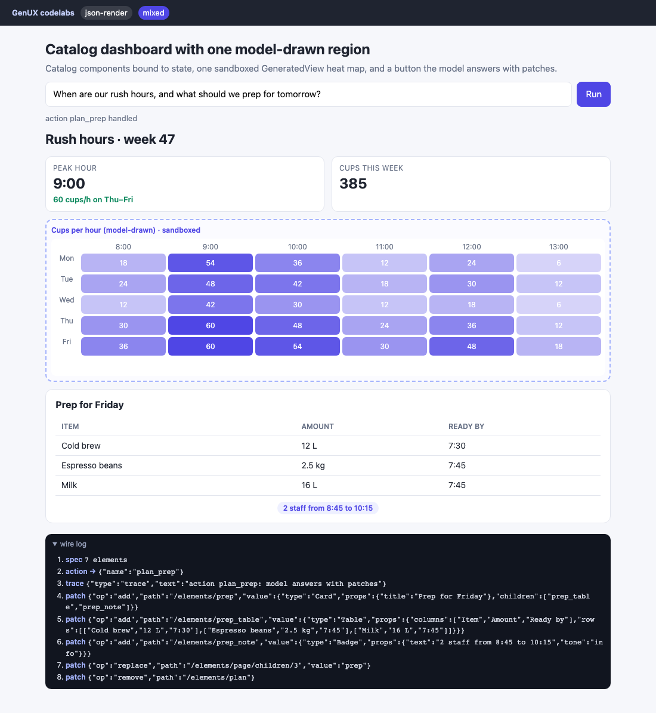

# json-render · mixed: a catalog dashboard with one model-drawn region

**Mode: mixed.** The dashboard is catalog components bound to state. One element, the rush-hour heat map, is a `GeneratedView` whose HTML the model writes, because no catalog component draws a heat map. A button round-trips to the model, which answers with patches. The same final spec is also drawn by a terminal renderer: one spec, two renderers. The HTML region degrades to a one-line note.

## Run it

```bash
python 04_json_render/4_mixed/demo.py
```

## Execution

The demo clicks **Plan tomorrow's prep**. The note at the end is the same final spec drawn by `render_terminal`.

<!-- OUTPUT -->
```text
$ python 04_json_render/4_mixed/demo.py

POST api/run  {"prompt":"When are our rush hours, and what should we prep for tomorrow?"}
  <- spec {"spec":{"root":"page","elements":{"page":{"type":"Column","children":["title","kpis","heat","plan"]},"title":{"type":"Text","pro…
POST api/action  {"name":"plan_prep","context":{},"spec":{"root":"page","elements":{"page":{"type":"Column","children":["title…
  <- trace {"text":"action plan_prep: model answers with patches"}
  <- patch x5  (first: {"op":{"op":"add","path":"/elements/prep","value":{"type":"Card","prop)

the same final spec, drawn by the terminal renderer (jsonrender.render_terminal):
  RUSH HOURS · WEEK 47
  Peak hour: 9:00 60 cups/h on Thu–Fri
  Cups this week: 385
  [Cups per hour (model-drawn): HTML region, shown only in a browser]
  ┌─ Prep for Friday ─────────────────────────────────────────
    Item           | Amount         | Ready by
    Cold brew      | 12 L           | 7:30
    Espresso beans | 2.5 kg         | 7:45
    Milk           | 16 L           | 7:45
    [2 staff from 8:45 to 10:15]

screenshots: demo_before.png, demo.png   (2 request(s), 1.7s)
```
<!-- /OUTPUT -->

| Dashboard with the generated heat map | After "Plan tomorrow's prep" |
|---|---|
|  |  |

## Code walkthrough

### 1. One region of free HTML

`agent.py`, in the model's spec:

```python
    "heat": {"type": "GeneratedView", "props": {"title": "Cups per hour (model-drawn)", "html": HEATMAP, "height": 230}},
```

and the rule that keeps it to one:

```python
    if sum(el["type"] == "GeneratedView" for el in spec["elements"].values()) > 1:
        errors.append("use at most one GeneratedView")
```

### 2. An action answered with patches

`agent.py` applies and forwards each line of the model's answer, skipping any that would break the spec:

```python
        candidate = jsonrender.apply_line(spec, line)
        if not jsonrender.validate(candidate, complete=False):
            spec = candidate
            yield {"type": "patch", "op": json.loads(line)}
```

### 3. A second renderer

`../jsonrender.py` draws the same element types as text. A `GeneratedView` cannot run in a terminal, so it becomes a note:

```python
        elif t == "GeneratedView":
            lines.append(f"{pad}[{p.get('title', 'generated view')}: HTML region, shown only in a browser]")
```

## What to notice

- Metrics and the prep table are validated catalog components. Only the heat map is free-form.
- The terminal output shows what each surface can promise. Catalog components travel; the generated region does not.
- The prep plan arrived as 5 patches that add a card and remove the button.

## Compared with open-ended

Open-ended opened the whole vocabulary. Mixed keeps the catalog for anything with numbers or actions and opens exactly one region.
