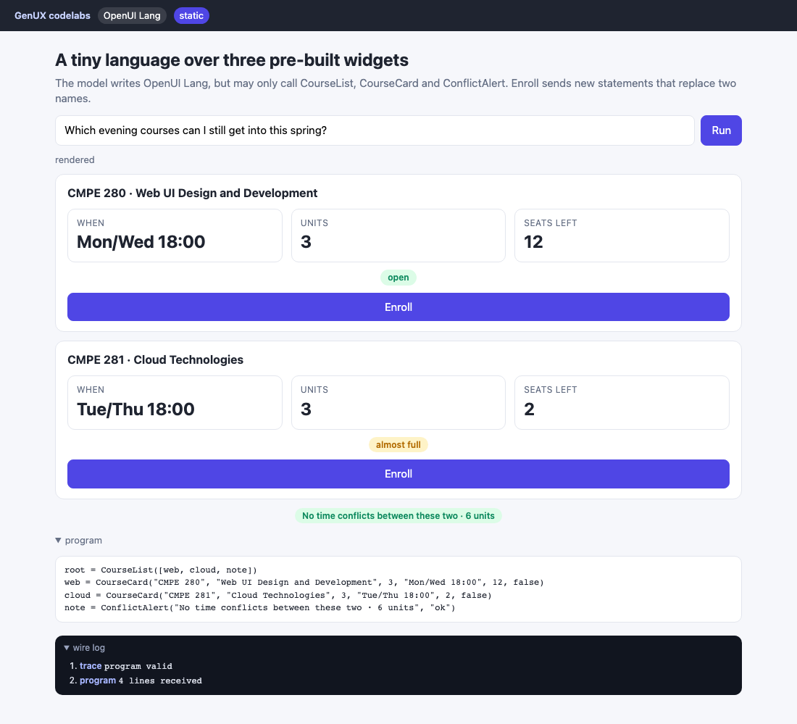
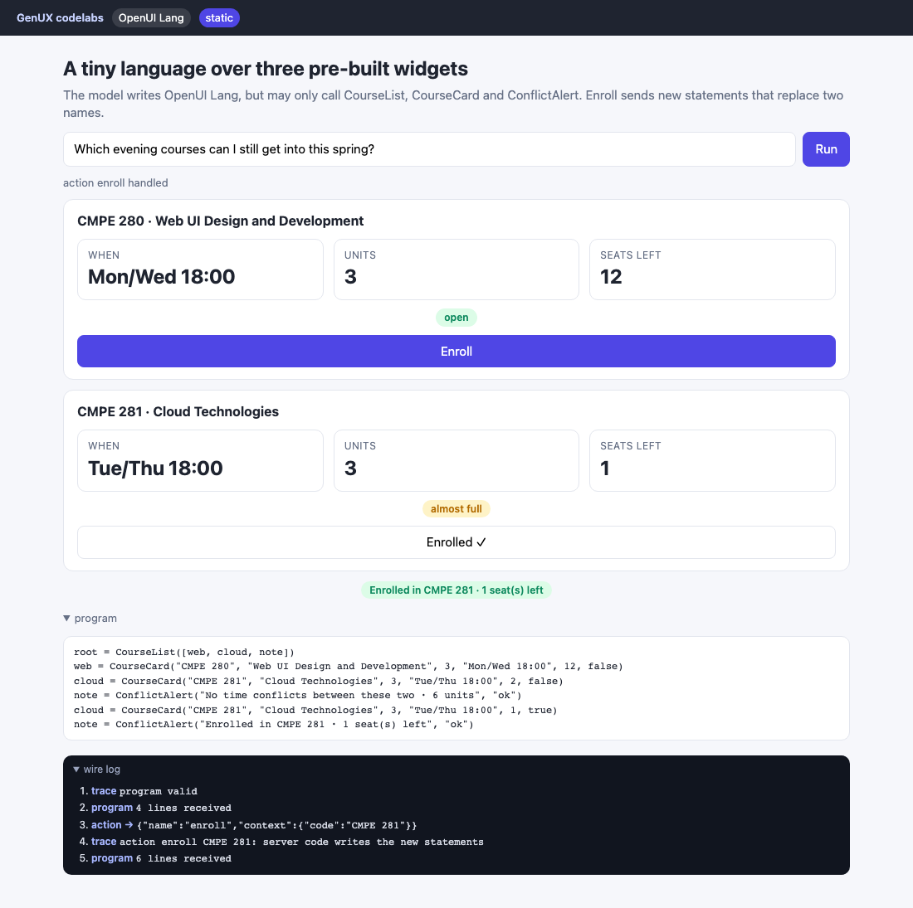

# OpenUI Lang · static: a tiny language over three pre-built widgets

**Mode: static.** The model writes an OpenUI Lang program, but it may call only `CourseList`, `CourseCard` and `ConflictAlert`. Their renderers are hand-written in `app.js`. The server checks every card against the registrar's data. **Enroll** is handled by server code, which answers with two new statements: re-assigning `cloud` and `note` replaces exactly those two parts of the screen.

## Run it

```bash
python 05_openui_lang/1_static/demo.py
```

## Execution

The demo clicks **Enroll** on CMPE 281.

<!-- OUTPUT -->
```text
$ python 05_openui_lang/1_static/demo.py

POST api/run  {"prompt":"Which evening courses can I still get into this spring?"}
  <- chunk x14  (first: {"text":"root = CourseList([web, "})
  <- trace {"text":"program valid"}
  <- end {}
POST api/action  {"name":"enroll","context":{"code":"CMPE 281"}}
  <- trace {"text":"action enroll CMPE 281: server code writes the new statements"}
  <- chunk {"text":"cloud = CourseCard(\"CMPE 281\", \"Cloud Technologies\", 3, \"Tue/Thu 18:00\", 1, true)\n"}
  <- chunk {"text":"note = ConflictAlert(\"Enrolled in CMPE 281 · 1 seat(s) left\", \"ok\")\n"}
  <- end {}

screenshots: demo_before.png, demo.png   (2 request(s), 2.1s)
```
<!-- /OUTPUT -->

| The model's program, drawn by pre-built widgets | After "Enroll" |
|---|---|
|  |  |

## Code walkthrough

### 1. The widget catalog

`agent.py` lists the three widgets and their parameter order. Nothing else parses:

```python
WIDGETS = {"CourseList": ["children"], "CourseCard": ["code", "title", "units", "when", "seats", "enrolled"],
           "ConflictAlert": ["text", "tone"]}
```

### 2. The model's facts are checked

`agent.py` compares every `CourseCard` with the registrar's record:

```python
            if not truth or any(p[k] != truth[k] for k in ("title", "units", "when", "seats")):
                errors.append(f"CourseCard {p['code']} does not match the registrar's data")
```

### 3. Hand-written widgets

`app.js` draws a `CourseCard` from catalog primitives, with an Enroll button the model did not write:

```js
  CourseCard: (p, ctx) => {
    const button = c("Button", { label: p.enrolled ? "Enrolled ✓" : "Enroll", action: "enroll", variant: p.enrolled ? "default" : "primary" },
```

### 4. An update is two statements

`agent.py` writes the new lines itself. The page appends them, and the later assignments win:

```python
        yield {"type": "chunk", "text": card(NAMES[code], code, enrolled=True) + "\n"}
        yield {"type": "chunk", "text": f'note = ConflictAlert("Enrolled in {code} · {COURSES[code]["seats"]} seat(s) left", "ok")\n'}
```

## What to notice

- The program is short (about 70 tokens) because each widget is coarse.
- The update did not resend the list or the other card.
- The language is the same in all four modes. Only the catalog changes how much freedom the model has.
