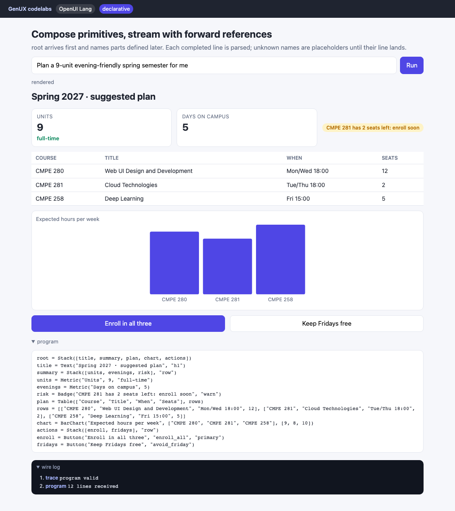
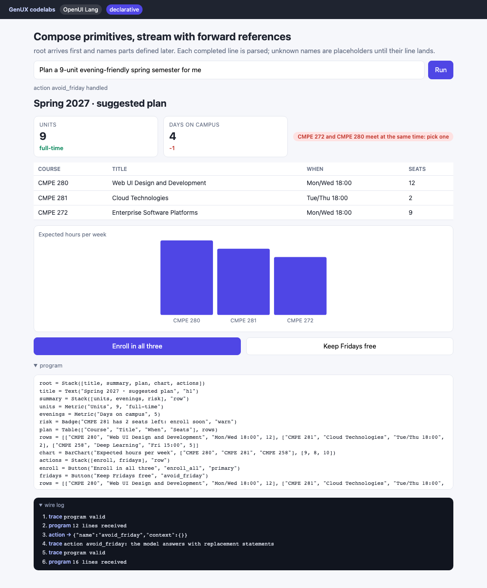

# OpenUI Lang · declarative: compose primitives, stream with forward references

**Mode: declarative.** The model composes the plan from primitives. The program starts with `root` and names parts that are defined later. The page parses after every completed line: unknown names render as placeholders, then fill in as their lines arrive. **Keep Fridays free** returns new statements; each re-assigned name replaces its part of the UI.

## Run it

```bash
python 05_openui_lang/2_declarative/demo.py
```

## Execution

The browser console shows the placeholder count rising and falling as the stream arrives: `root` names five parts at once, and they resolve line by line.

<!-- OUTPUT -->
```text
$ python 05_openui_lang/2_declarative/demo.py

POST api/run  {"prompt":"Plan a 9-unit evening-friendly spring semester for me"}
  <- chunk x33  (first: {"text":"root = Stack([title, sum"})
  <- trace {"text":"program valid"}
  <- end {}
POST api/action  {"name":"avoid_friday","context":{}}
  <- trace {"text":"action avoid_friday: the model answers with replacement statements"}
  <- chunk x18  (first: {"text":"rows = [[\"CMPE 280\", \"We"})
  <- trace {"text":"program valid"}
  <- end {}

browser console:
  [genux] 0 statement(s) parsed, 0 placeholder(s) on screen
  [genux] 1 statement(s) parsed, 5 placeholder(s) on screen
  [genux] 2 statement(s) parsed, 4 placeholder(s) on screen
  [genux] 3 statement(s) parsed, 6 placeholder(s) on screen
  [genux] 4 statement(s) parsed, 5 placeholder(s) on screen
  [genux] 5 statement(s) parsed, 4 placeholder(s) on screen
  [genux] 6 statement(s) parsed, 3 placeholder(s) on screen
  [genux] 8 statement(s) parsed, 2 placeholder(s) on screen
  [genux] 9 statement(s) parsed, 1 placeholder(s) on screen
  [genux] 10 statement(s) parsed, 2 placeholder(s) on screen
  [genux] 11 statement(s) parsed, 1 placeholder(s) on screen
  [genux] 12 statement(s) parsed, 0 placeholder(s) on screen

the streamed program:
  root = Stack([title, summary, plan, chart, actions])
  title = Text("Spring 2027 · suggested plan", "h1")
  summary = Stack([units, evenings, risk], "row")
  units = Metric("Units", 9, "full-time")
  evenings = Metric("Days on campus", 5)
  risk = Badge("CMPE 281 has 2 seats left: enroll soon", "warn")
  plan = Table(["Course", "Title", "When", "Seats"], rows)
  rows = [["CMPE 280", "Web UI Design and Development", "Mon/Wed 18:00", 12], ["CMPE 281", "Cloud Technologies",
  chart = BarChart("Expected hours per week", ["CMPE 280", "CMPE 281", "CMPE 258"], [9, 8, 10])
  actions = Stack([enroll, fridays], "row")
  enroll = Button("Enroll in all three", "enroll_all", "primary")
  fridays = Button("Keep Fridays free", "avoid_friday")
the action's answer (four re-assigned names):
  rows = [["CMPE 280", "Web UI Design and Development", "Mon/Wed 18:00", 12], ["CMPE 281", "Cloud Technologies",
  chart = BarChart("Expected hours per week", ["CMPE 280", "CMPE 281", "CMPE 272"], [9, 8, 7])
  evenings = Metric("Days on campus", 4, "-1")
  risk = Badge("CMPE 272 and CMPE 280 meet at the same time: pick one", "bad")

screenshots: demo_before.png, demo.png   (2 request(s), 2.8s)
```
<!-- /OUTPUT -->

| The streamed plan | After "Keep Fridays free" |
|---|---|
|  |  |

## Code walkthrough

### 1. Root first, details later

`agent.py`, the first lines of the model's program. `plan` uses `rows`, which arrives two lines later:

```python
PLAN = """root = Stack([title, summary, plan, chart, actions])
```

```python
plan = Table(["Course", "Title", "When", "Seats"], rows)
```

### 2. A placeholder for a prop, not only for a child

`../openui.mjs` draws a component that is still waiting for a referenced prop as a short note:

```js
  const waiting = Object.values(props).find((v) => v && v.type === "_pending");
  if (waiting) return renderComponent("Text", { text: `… ${node.type} waits for ${waiting.name}`, variant: "muted" });
```

### 3. The server validates the finished program

`agent.py` runs the full check when the stream ends: syntax, unknown components, undefined names and catalog props:

```python
                              lambda text: openui.check(text, openui.PRIMITIVES)[1])
```

### 4. Updates re-assign names

`agent.py`, the model's answer to the action. Four lines, and the table, chart, metric and badge change:

```python
NO_FRIDAY = """rows = [["CMPE 280", "Web UI Design and Development", "Mon/Wed 18:00", 12], ["CMPE 281", "Cloud Technologies", "Tue/Thu 18:00", 2], ["CMPE 272", "Enterprise Software Platforms", "Mon/Wed 18:00", 9]]
```

## What to notice

- The model honestly flags that CMPE 272 and CMPE 280 clash; the badge turns red.
- Forward references let the outline appear first, which is how a person would sketch it.
- The program is about 200 tokens, against 70 for the static widgets.

## Compared with static

Static used three coarse widgets. Here the model lays out primitives and chooses the summary metrics and chart itself.
