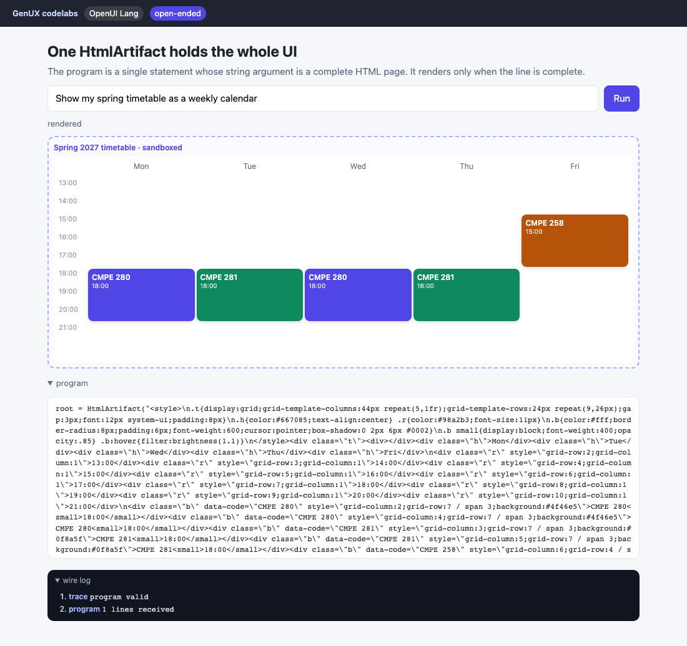
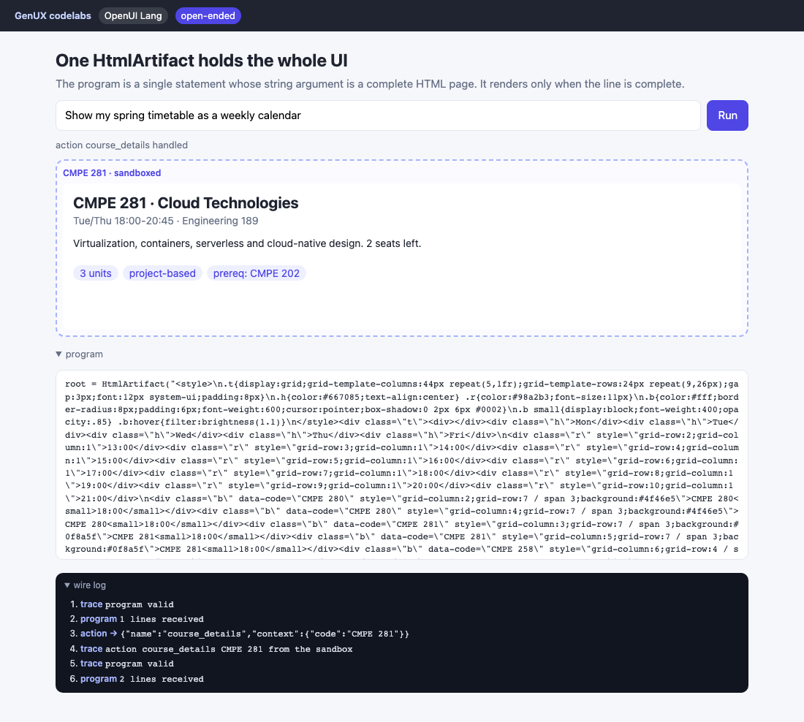

# OpenUI Lang · open-ended: one HtmlArtifact holds the whole UI

**Mode: open-ended.** The only component is `HtmlArtifact(html, title, height)`. The model writes a complete weekly timetable as HTML inside an OpenUI string literal, so every quote and newline is escaped. Nothing can render until the line is complete, because the parser reads only finished statements. A click in the sandbox becomes an action; the model answers with a new `root`.

## Run it

```bash
python 05_openui_lang/3_open_ended/demo.py
```

## Execution

The demo clicks the CMPE 281 block inside the sandbox. The note at the end compares the three modes and counts the escapes.

<!-- OUTPUT -->
```text
$ python 05_openui_lang/3_open_ended/demo.py

POST api/run  {"prompt":"Show my spring timetable as a weekly calendar"}
  <- chunk x87  (first: {"text":"root = HtmlArtifact(\"<st"})
  <- trace {"text":"program valid"}
  <- end {}
POST api/action  {"name":"course_details","context":{"code":"CMPE 281"}}
  <- trace {"text":"action course_details CMPE 281 from the sandbox"}
  <- chunk x26  (first: {"text":"root = HtmlArtifact(\"<st"})
  <- trace {"text":"program valid"}
  <- end {}

browser console:
  [genux] painted once the line was complete: 1 statement
  [genux] painted once the line was complete: 1 statement

model output size (tokens, estimated):
  static (3 widgets)              72
  declarative (primitives)       196
  open-ended (HtmlArtifact)      516
the open-ended line carries 93 backslash escapes, and nothing renders until its last character

screenshots: demo_before.png, demo.png   (2 request(s), 2.4s)
```
<!-- /OUTPUT -->

| The model's timetable | After clicking CMPE 281 |
|---|---|
|  |  |

## Code walkthrough

### 1. One statement

`agent.py` builds the model's reply as a single line. `json.dumps` produces exactly the escaping an OpenUI string needs:

```python
line = lambda html, title, height: f"root = HtmlArtifact({json.dumps(html)}, {json.dumps(title)}, {height})"  # noqa: E731
```

### 2. The catalog is one component

`../openui.py`:

```python
HTML_ARTIFACT = {"HtmlArtifact": ["html", "title", "height"]}
```

The program check runs the content policy on the HTML argument:

```python
            if node["type"] == "HtmlArtifact":
                errors.extend(f"{path}: {p}" for p in check_html(node["props"].get("html", "")))
```

### 3. Rendered as a GeneratedView

`../openui.mjs` maps `HtmlArtifact` to the shared sandboxed component:

```js
  if (node.type === "HtmlArtifact") return renderComponent("GeneratedView", props, [], ctx);
```

## What to notice

- The page stays empty for the whole stream, then the timetable appears at once.
- The open-ended program is about 2.6 times the declarative one, and much of the difference is CSS and escaping.
- The language still helps: the update is one `root = ...` line, and the content policy runs on a known argument.

## Compared with declarative

Declarative streamed visible progress line by line. Here a single long line carries everything, so streaming gives no early paint.
