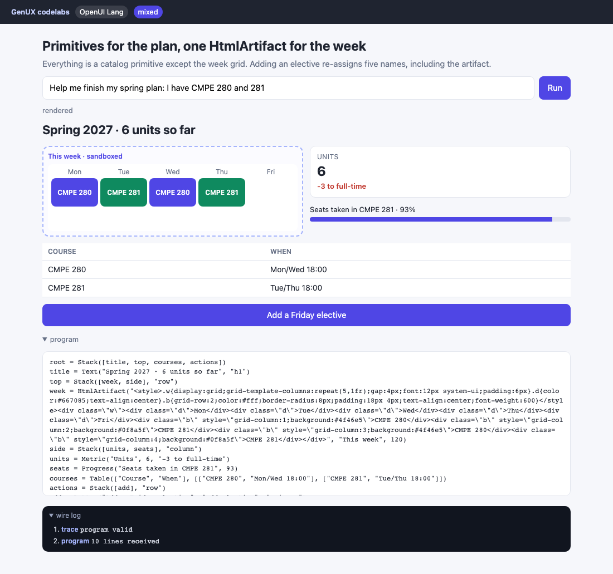
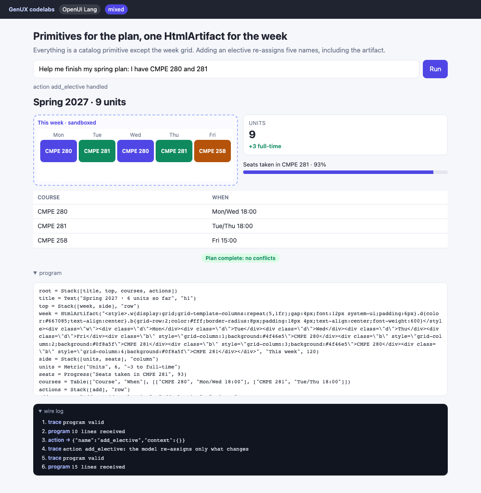

# OpenUI Lang · mixed: primitives for the plan, one HtmlArtifact for the week

**Mode: mixed.** The title, metrics, progress bar, course table and button are primitives. Only the week grid, which no primitive draws, is an `HtmlArtifact`. When the user adds an elective, the model answers with statements that re-assign five names, including the artifact. Everything else stays on screen.

## Run it

```bash
python 05_openui_lang/4_mixed/demo.py
```

## Execution

The demo clicks **Add a Friday elective**.

<!-- OUTPUT -->
```text
$ python 05_openui_lang/4_mixed/demo.py

POST api/run  {"prompt":"Help me finish my spring plan: I have CMPE 280 and 281"}
  <- chunk x50  (first: {"text":"root = Stack([title, top"})
  <- trace {"text":"program valid"}
  <- end {}
POST api/action  {"name":"add_elective","context":{}}
  <- trace {"text":"action add_elective: the model re-assigns only what changes"}
  <- chunk x45  (first: {"text":"week = HtmlArtifact(\"<st"})
  <- trace {"text":"program valid"}
  <- end {}

the action re-assigned 5 names (week, units, courses, title, actions); the other 5 statements were reused

screenshots: demo_before.png, demo.png   (2 request(s), 3.0s)
```
<!-- /OUTPUT -->

| 6 units | After adding the elective |
|---|---|
|  |  |

## Code walkthrough

### 1. Both catalogs, one rule

`agent.py` allows primitives and the artifact, and rejects a second artifact:

```python
COMPONENTS = {**openui.PRIMITIVES, **openui.HTML_ARTIFACT}
```

```python
        if text.count("HtmlArtifact(") > 1:
            errors.append("use at most one HtmlArtifact")
```

### 2. The artifact is one named statement

`agent.py`, the week grid as a statement like any other:

```python
art = lambda blocks: f'week = HtmlArtifact({json.dumps(week(blocks))}, "This week", 120)'  # noqa: E731
```

### 3. The update

`agent.py`, the model's answer. Re-assigning `week` re-renders only the sandboxed grid; the other lines update catalog parts:

```python
    art(BASE + [("CMPE 258", 4, "#b45309")]),
    'units = Metric("Units", 9, "+3 full-time")',
```

## What to notice

- Five names changed, five did not. The structure (`root`, `top`, `side`) was reused.
- The `actions` name changed type, from a `Stack` with a button to a `Badge`. Re-assignment can change what a name is.
- The free-form part is limited to the grid, so the numbers stay in validated components.

## Compared with open-ended

Open-ended put the entire screen in one escaped string. Here the string is one statement among ten, and the rest streams and updates statement by statement.
