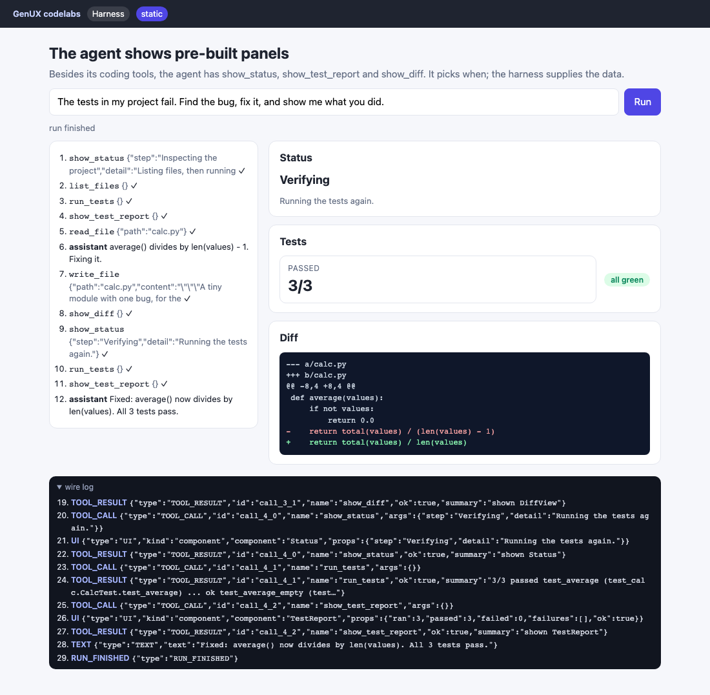

# Harness · static: the agent shows pre-built panels

**Mode: static.** Besides its coding tools, the model has three UI tools: `show_status`, `show_test_report` and `show_diff`. The model decides *when* to show a panel. The harness supplies the *data*: test numbers from the real test run and the diff from the real file change. The web page and the terminal draw the same events.

## Run it

```bash
python 06_harness/1_static/demo.py
```

## Execution

One request runs the whole session: inspect, run tests (2/3 pass), read, fix, show the diff, run tests again (3/3). The second half of the output is the terminal surface for the same run.

<!-- OUTPUT -->
```text
$ python 06_harness/1_static/demo.py

POST api/run  {"prompt":"The tests in my project fail. Find the bug, fix it, and show me what you did."}
  <- RUN_STARTED {"workspace":"genux-harness-v8qd_3yu"}
  <- TOOL_CALL {"id":"call_1_0","name":"show_status","args":{"step":"Inspecting the project","detail":"Listing files, then running the tests."}}
  <- UI {"kind":"component","component":"Status","props":{"step":"Inspecting the project","detail":"Listing files, then running the tests…
  <- TOOL_RESULT {"id":"call_1_0","name":"show_status","ok":true,"summary":"shown Status"}
  <- TOOL_CALL {"id":"call_1_1","name":"list_files","args":{}}
  <- TOOL_RESULT {"id":"call_1_1","name":"list_files","ok":true,"summary":"calc.py test_calc.py"}
  <- TOOL_CALL {"id":"call_1_2","name":"run_tests","args":{}}
  <- TOOL_RESULT {"id":"call_1_2","name":"run_tests","ok":true,"summary":"2/3 passed; failing: test_average test_average (test_calc.CalcTest.test_…
  <- TOOL_CALL {"id":"call_2_0","name":"show_test_report","args":{}}
  <- UI {"kind":"component","component":"TestReport","props":{"ran":3,"passed":2,"failed":1,"failures":["test_average"],"ok":false}}
  <- TOOL_RESULT {"id":"call_2_0","name":"show_test_report","ok":true,"summary":"shown TestReport"}
  <- TOOL_CALL {"id":"call_2_1","name":"read_file","args":{"path":"calc.py"}}
  <- TOOL_RESULT {"id":"call_2_1","name":"read_file","ok":true,"summary":"\"\"\"A tiny module with one bug, for the harness to find and fix.\"\"\"…
  <- TEXT {"text":"average() divides by len(values) - 1. Fixing it."}
  <- TOOL_CALL {"id":"call_3_0","name":"write_file","args":{"path":"calc.py","content":"\"\"\"A tiny module with one bug, for the harness to fin…
  <- TOOL_RESULT {"id":"call_3_0","name":"write_file","ok":true,"summary":"wrote calc.py (211 chars)"}
  <- TOOL_CALL {"id":"call_3_1","name":"show_diff","args":{}}
  <- UI {"kind":"component","component":"DiffView","props":{"diff":"--- a/calc.py\n+++ b/calc.py\n@@ -8,4 +8,4 @@\n def average(values):\…
  <- TOOL_RESULT {"id":"call_3_1","name":"show_diff","ok":true,"summary":"shown DiffView"}
  <- TOOL_CALL {"id":"call_4_0","name":"show_status","args":{"step":"Verifying","detail":"Running the tests again."}}
  <- UI {"kind":"component","component":"Status","props":{"step":"Verifying","detail":"Running the tests again."}}
  <- TOOL_RESULT {"id":"call_4_0","name":"show_status","ok":true,"summary":"shown Status"}
  <- TOOL_CALL {"id":"call_4_1","name":"run_tests","args":{}}
  <- TOOL_RESULT {"id":"call_4_1","name":"run_tests","ok":true,"summary":"3/3 passed test_average (test_calc.CalcTest.test_average) ... ok test_av…
  <- TOOL_CALL {"id":"call_4_2","name":"show_test_report","args":{}}
  <- UI {"kind":"component","component":"TestReport","props":{"ran":3,"passed":3,"failed":0,"failures":[],"ok":true}}
  <- TOOL_RESULT {"id":"call_4_2","name":"show_test_report","ok":true,"summary":"shown TestReport"}
  <- TEXT {"text":"Fixed: average() now divides by len(values). All 3 tests pass."}
  <- RUN_FINISHED {}

the same run on the terminal surface (terminal.py):
● run started in genux-harness-v8qd_3yu
  → show_status({"step": "Inspecting the project", "detail": "Listing files, then running the te)
  ▸ Inspecting the project: Listing files, then running the tests.
    ✓ shown Status
  → list_files({})
    ✓ calc.py test_calc.py
  → run_tests({})
    ✓ 2/3 passed; failing: test_average test_average (test_calc.CalcTest.test_average) ... FAIL…
  → show_test_report({})
  ▸ tests: 2/3 passed, failing: test_average
    ✓ shown TestReport
  → read_file({"path": "calc.py"})
    ✓ """A tiny module with one bug, for the harness to find and fix.""" def total(values): ret…
assistant: average() divides by len(values) - 1. Fixing it.
  → write_file({"path": "calc.py", "content": "\"\"\"A tiny module with one bug, for the harnes)
    ✓ wrote calc.py (211 chars)
  → show_diff({})
  ▸ diff:
      --- a/calc.py
      +++ b/calc.py
      @@ -8,4 +8,4 @@
       def average(values):
           if not values:
               return 0.0
      -    return total(values) / (len(values) - 1)
      +    return total(values) / len(values)
    ✓ shown DiffView
  → show_status({"step": "Verifying", "detail": "Running the tests again."})
  ▸ Verifying: Running the tests again.
    ✓ shown Status
  → run_tests({})
    ✓ 3/3 passed test_average (test_calc.CalcTest.test_average) ... ok test_average_empty (test…
  → show_test_report({})
  ▸ tests: 3/3 passed
    ✓ shown TestReport
assistant: Fixed: average() now divides by len(values). All 3 tests pass.
● run finished

screenshots: demo.png   (1 request(s), 1.3s)
```
<!-- /OUTPUT -->



## Code walkthrough

### 1. UI tools take no data from the model

`agent.py`: `show_test_report` and `show_diff` have no parameters. The harness reads its own state:

```python
        "show_test_report": harness.Tool(tool("show_test_report", "Show the latest test results.", {}),
                                         lambda: emit("TestReport", s.last_tests or {"ran": 0, "passed": 0, "failed": 0, "failures": []})),
        "show_diff": harness.Tool(tool("show_diff", "Show your changes as a diff.", {}),
                                  lambda: emit("DiffView", {"diff": harness.unified_diff(s)})),
```

### 2. The numbers come from a real test run

`../harness.py` runs the toy project's tests and parses the result:

```python
        proc = subprocess.run([sys.executable, "-m", "unittest", "-v"], cwd=s.workspace, capture_output=True,
                              text=True, timeout=60)
```

### 3. One panel per component, on each surface

`app.js` has the web renderers; `agent.py` has the terminal ones:

```js
  TestReport: (p) => c("Card", { title: "Tests" }, [
```

`agent.py`, the terminal version of the same panel:

```python
    "TestReport": lambda p: [f"  ▸ tests: {p['passed']}/{p['ran']} passed" + (f", failing: {', '.join(p['failures'])}" if p["failures"] else "")],
```

### 4. Panels are replaced, not stacked

`../client.mjs` keeps one panel per component name, so the second test report replaces the first:

```js
  const place = (key, node) => {
    if (panels.has(key)) panels.get(key).replaceWith(node);
```

## What to notice

- The model cannot misreport the tests: it never writes the numbers.
- The diff is computed by `difflib` from the real before and after.
- This is the cheapest way to add UI to an agent: three tools, no schema for the model to learn.
