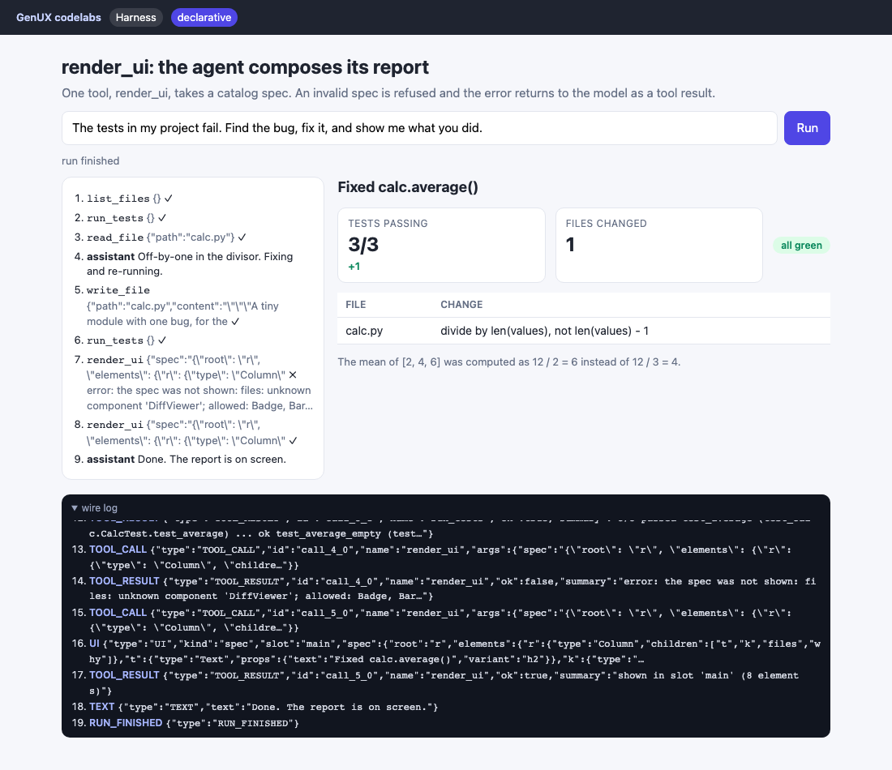

# Harness · declarative: render_ui, and validation errors as tool results

**Mode: declarative.** One UI tool, `render_ui`, takes a catalog spec. The model composes its own fix report. The harness validates the spec; an invalid spec is not shown, and the error goes back to the model as the tool result, so it corrects itself inside the normal loop. The terminal draws the same spec with the json-render terminal renderer.

## Run it

```bash
python 06_harness/2_declarative/demo.py
```

## Execution

The model's first `render_ui` used a `DiffViewer` component that does not exist. The tool result says so, and the next call succeeds.

<!-- OUTPUT -->
```text
$ python 06_harness/2_declarative/demo.py

POST api/run  {"prompt":"The tests in my project fail. Find the bug, fix it, and show me what you did."}
  <- RUN_STARTED {"workspace":"genux-harness-0c7qn06x"}
  <- TOOL_CALL {"id":"call_1_0","name":"list_files","args":{}}
  <- TOOL_RESULT {"id":"call_1_0","name":"list_files","ok":true,"summary":"calc.py test_calc.py"}
  <- TOOL_CALL {"id":"call_1_1","name":"run_tests","args":{}}
  <- TOOL_RESULT {"id":"call_1_1","name":"run_tests","ok":true,"summary":"2/3 passed; failing: test_average test_average (test_calc.CalcTest.test_…
  <- TOOL_CALL {"id":"call_2_0","name":"read_file","args":{"path":"calc.py"}}
  <- TOOL_RESULT {"id":"call_2_0","name":"read_file","ok":true,"summary":"\"\"\"A tiny module with one bug, for the harness to find and fix.\"\"\"…
  <- TEXT {"text":"Off-by-one in the divisor. Fixing and re-running."}
  <- TOOL_CALL {"id":"call_3_0","name":"write_file","args":{"path":"calc.py","content":"\"\"\"A tiny module with one bug, for the harness to fin…
  <- TOOL_RESULT {"id":"call_3_0","name":"write_file","ok":true,"summary":"wrote calc.py (211 chars)"}
  <- TOOL_CALL {"id":"call_3_1","name":"run_tests","args":{}}
  <- TOOL_RESULT {"id":"call_3_1","name":"run_tests","ok":true,"summary":"3/3 passed test_average (test_calc.CalcTest.test_average) ... ok test_av…
  <- TOOL_CALL {"id":"call_4_0","name":"render_ui","args":{"spec":"{\"root\": \"r\", \"elements\": {\"r\": {\"type\": \"Column\", \"childre…"}}
  <- TOOL_RESULT {"id":"call_4_0","name":"render_ui","ok":false,"summary":"error: the spec was not shown: files: unknown component 'DiffViewer'; a…
  <- TOOL_CALL {"id":"call_5_0","name":"render_ui","args":{"spec":"{\"root\": \"r\", \"elements\": {\"r\": {\"type\": \"Column\", \"childre…"}}
  <- UI {"kind":"spec","slot":"main","spec":{"root":"r","elements":{"r":{"type":"Column","children":["t","k","files","why"]},"t":{"type":…
  <- TOOL_RESULT {"id":"call_5_0","name":"render_ui","ok":true,"summary":"shown in slot 'main' (8 elements)"}
  <- TEXT {"text":"Done. The report is on screen."}
  <- RUN_FINISHED {}

the same run on the terminal surface (terminal.py + the json-render terminal renderer):
● run started in genux-harness-0c7qn06x
  → list_files({})
    ✓ calc.py test_calc.py
  → run_tests({})
    ✓ 2/3 passed; failing: test_average test_average (test_calc.CalcTest.test_average) ... FAIL…
  → read_file({"path": "calc.py"})
    ✓ """A tiny module with one bug, for the harness to find and fix.""" def total(values): ret…
assistant: Off-by-one in the divisor. Fixing and re-running.
  → write_file({"path": "calc.py", "content": "\"\"\"A tiny module with one bug, for the harnes)
    ✓ wrote calc.py (211 chars)
  → run_tests({})
    ✓ 3/3 passed test_average (test_calc.CalcTest.test_average) ... ok test_average_empty (test…
  → render_ui({"spec": "{\"root\": \"r\", \"elements\": {\"r\": {\"type\": \"Column\", \"child)
    ✗ error: the spec was not shown: files: unknown component 'DiffViewer'; allowed: Badge, Bar…
  → render_ui({"spec": "{\"root\": \"r\", \"elements\": {\"r\": {\"type\": \"Column\", \"child)
  ┌ render_ui
  │ FIXED CALC.AVERAGE()
  │ Tests passing: 3/3 +1
  │ Files changed: 1
  │ [all green]
  │ File           | Change
  │ calc.py        | divide by len(values), not len(values) - 1
  │ The mean of [2, 4, 6] was computed as 12 / 2 = 6 instead of 12 / 3 = 4.
    ✓ shown in slot 'main' (8 elements)
assistant: Done. The report is on screen.
● run finished

screenshots: demo.png   (1 request(s), 1.2s)
```
<!-- /OUTPUT -->



## Code walkthrough

### 1. The tool's description is the catalog

`../ui_tools.py` puts the catalog into the tool schema, so the model learns the components from the tool list:

```python
    schema = tool("render_ui", "Show a UI built from catalog components as {root, elements:{id:{type, props, children}}}. "
                  "Components:\n" + prompt_text(allowed),
```

### 2. Refuse, explain, continue

`../ui_tools.py` returns an error string instead of raising. The loop appends it as a tool result:

```python
            return "error: the spec was not shown: " + "; ".join(errors)
```

### 3. The model's two attempts

`agent.py`, the scripted replies. The broken spec differs in one element:

```python
BROKEN = {"root": "r", "elements": {**REPORT["elements"],
                                    "files": {"type": "DiffViewer", "props": {"file": "calc.py"}}}}
```

### 4. One spec, two surfaces

`../terminal.py` draws a spec event with the json-render terminal renderer from theme 04:

```python
        return ["  ┌ render_ui"] + ["  │ " + line for line in render_terminal(event["spec"]).splitlines()]
```

## What to notice

- No special retry code exists. The correction is an ordinary turn of the agent loop.
- The web page shows only the valid report; the failed attempt is visible in the step list as ✗.
- The terminal output is readable because the catalog components have a text form.

## Compared with static

Static had three fixed panels. Here the model designs the report, and the harness's job becomes validation.
