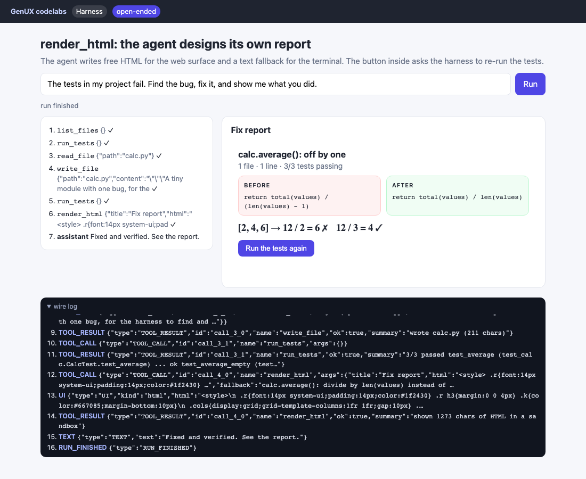
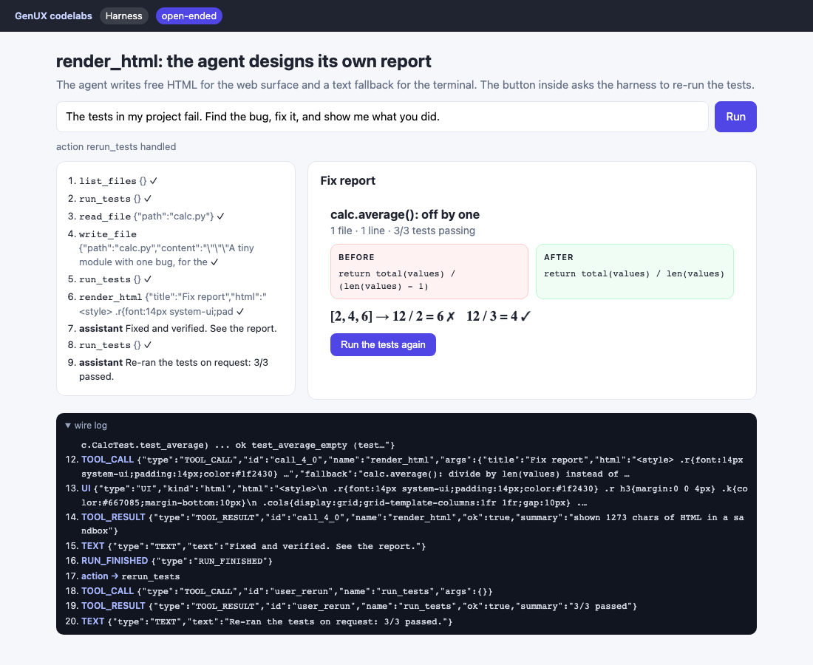

# Harness · open-ended: render_html, with a fallback for the terminal

**Mode: open-ended.** `render_html` lets the model write any HTML for the web surface, such as a fix report with before and after code side by side. The harness checks the content policy, the page shows the HTML in a sandbox, and the terminal shows the plain-text `fallback` the tool requires, because a terminal cannot run HTML. A button in the report asks the harness to re-run the tests.

## Run it

```bash
python 06_harness/3_open_ended/demo.py
```

## Execution

The demo clicks **Run the tests again** inside the sandbox. The harness runs the real tests again without a model call.

<!-- OUTPUT -->
```text
$ python 06_harness/3_open_ended/demo.py

POST api/run  {"prompt":"The tests in my project fail. Find the bug, fix it, and show me what you did."}
  <- RUN_STARTED {"workspace":"genux-harness-l48q3xqg"}
  <- TOOL_CALL {"id":"call_1_0","name":"list_files","args":{}}
  <- TOOL_RESULT {"id":"call_1_0","name":"list_files","ok":true,"summary":"calc.py test_calc.py"}
  <- TOOL_CALL {"id":"call_1_1","name":"run_tests","args":{}}
  <- TOOL_RESULT {"id":"call_1_1","name":"run_tests","ok":true,"summary":"2/3 passed; failing: test_average test_average (test_calc.CalcTest.test_…
  <- TOOL_CALL {"id":"call_2_0","name":"read_file","args":{"path":"calc.py"}}
  <- TOOL_RESULT {"id":"call_2_0","name":"read_file","ok":true,"summary":"\"\"\"A tiny module with one bug, for the harness to find and fix.\"\"\"…
  <- TOOL_CALL {"id":"call_3_0","name":"write_file","args":{"path":"calc.py","content":"\"\"\"A tiny module with one bug, for the harness to fin…
  <- TOOL_RESULT {"id":"call_3_0","name":"write_file","ok":true,"summary":"wrote calc.py (211 chars)"}
  <- TOOL_CALL {"id":"call_3_1","name":"run_tests","args":{}}
  <- TOOL_RESULT {"id":"call_3_1","name":"run_tests","ok":true,"summary":"3/3 passed test_average (test_calc.CalcTest.test_average) ... ok test_av…
  <- TOOL_CALL {"id":"call_4_0","name":"render_html","args":{"title":"Fix report","html":"<style> .r{font:14px system-ui;padding:14px;color:#1f2…
  <- UI {"kind":"html","html":"<style>\n .r{font:14px system-ui;padding:14px;color:#1f2430} .r h3{margin:0 0 4px} .k{color:#667085;margin…
  <- TOOL_RESULT {"id":"call_4_0","name":"render_html","ok":true,"summary":"shown 1273 chars of HTML in a sandbox"}
  <- TEXT {"text":"Fixed and verified. See the report."}
  <- RUN_FINISHED {}
POST api/action  {"name":"rerun_tests"}
  <- TOOL_CALL {"id":"user_rerun","name":"run_tests","args":{}}
  <- TOOL_RESULT {"id":"user_rerun","name":"run_tests","ok":true,"summary":"3/3 passed"}
  <- TEXT {"text":"Re-ran the tests on request: 3/3 passed."}

the same run on the terminal surface (the HTML is replaced by its fallback):
● run started in genux-harness-l48q3xqg
  → list_files({})
    ✓ calc.py test_calc.py
  → run_tests({})
    ✓ 2/3 passed; failing: test_average test_average (test_calc.CalcTest.test_average) ... FAIL…
  → read_file({"path": "calc.py"})
    ✓ """A tiny module with one bug, for the harness to find and fix.""" def total(values): ret…
  → write_file({"path": "calc.py", "content": "\"\"\"A tiny module with one bug, for the harnes)
    ✓ wrote calc.py (211 chars)
  → run_tests({})
    ✓ 3/3 passed test_average (test_calc.CalcTest.test_average) ... ok test_average_empty (test…
  → render_html({"title": "Fix report", "html": "<style> .r{font:14px system-ui;padding:14px;col)
  ┌ render_html (browser only) · fallback: calc.average(): divide by len(values) instead of len(values) - 1. 3/3 tests pass.
    ✓ shown 1273 chars of HTML in a sandbox
assistant: Fixed and verified. See the report.
● run finished

screenshots: demo_before.png, demo.png   (2 request(s), 1.8s)
```
<!-- /OUTPUT -->

| The model's report | After "Run the tests again" |
|---|---|
|  |  |

## Code walkthrough

### 1. HTML plus a fallback

`../ui_tools.py`: both arguments are required, so every surface gets something:

```python
    def run(html: str, fallback: str, title: str = "render_html") -> str:
        problems = check_html(html)
        if problems:
            return "error: refused by the content policy: " + "; ".join(problems)
```

### 2. The terminal uses the fallback

`../terminal.py`:

```python
    if t == "UI" and event["kind"] == "html":
        return [f"  ┌ render_html (browser only) · fallback: {event['fallback']}"]
```

### 3. A sandbox button that the harness answers

`agent.py` handles the action itself, running the real test tool:

```python
    if name == "action" and body.get("name") == "rerun_tests":   # handled by the harness, not the model
        s = SESSIONS["current"]
        summary = s.tools["run_tests"].run().splitlines()[0]
```

## What to notice

- The report's layout (two colour-coded columns and the arithmetic) is more than the catalog offers.
- Its claims ("3/3 tests passing") are model-written text. The re-run button lets the user check them against a real run.
- The terminal transcript loses the visual report but keeps the meaning.

## Compared with declarative

Declarative validated components. Here the harness can only check what the HTML may *do*, not what it *says*.
