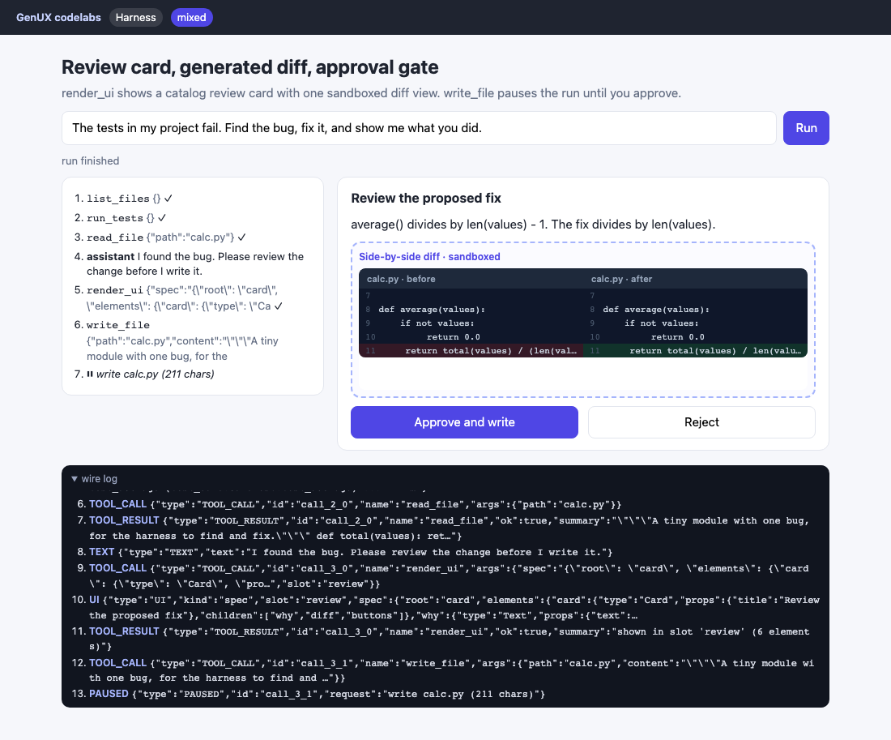
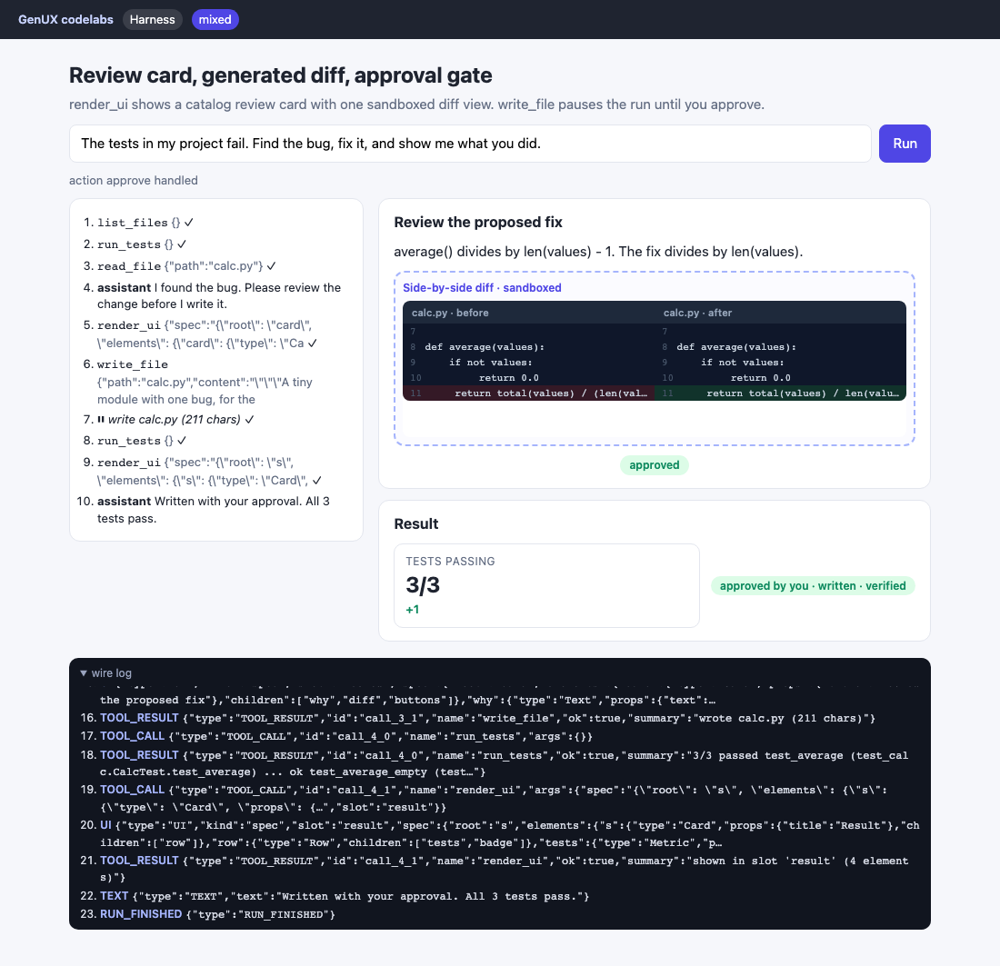

# Harness · mixed: review card, generated diff, approval gate

**Mode: mixed.** Three ideas combine:

* `render_ui` accepts catalog specs with at most one `GeneratedView`. The model uses it for a review card whose side-by-side diff is model-written HTML.
* `write_file` is gated: instead of writing, it raises `Pause`. The run stops and the review card waits on screen.
* **Approve** or **Reject** is an action. The harness finishes the paused tool call with that answer and continues the same loop: the model sees the result, runs the tests and shows a summary.

## Run it

```bash
python 06_harness/4_mixed/demo.py
```

## Execution

Two requests: the run that pauses, and the approval that resumes it. The terminal transcript covers both.

<!-- OUTPUT -->
```text
$ python 06_harness/4_mixed/demo.py

POST api/run  {"prompt":"The tests in my project fail. Find the bug, fix it, and show me what you did."}
  <- RUN_STARTED {"workspace":"genux-harness-4h5eurlt"}
  <- TOOL_CALL {"id":"call_1_0","name":"list_files","args":{}}
  <- TOOL_RESULT {"id":"call_1_0","name":"list_files","ok":true,"summary":"calc.py test_calc.py"}
  <- TOOL_CALL {"id":"call_1_1","name":"run_tests","args":{}}
  <- TOOL_RESULT {"id":"call_1_1","name":"run_tests","ok":true,"summary":"2/3 passed; failing: test_average test_average (test_calc.CalcTest.test_…
  <- TOOL_CALL {"id":"call_2_0","name":"read_file","args":{"path":"calc.py"}}
  <- TOOL_RESULT {"id":"call_2_0","name":"read_file","ok":true,"summary":"\"\"\"A tiny module with one bug, for the harness to find and fix.\"\"\"…
  <- TEXT {"text":"I found the bug. Please review the change before I write it."}
  <- TOOL_CALL {"id":"call_3_0","name":"render_ui","args":{"spec":"{\"root\": \"card\", \"elements\": {\"card\": {\"type\": \"Card\", \"pro…","s…
  <- UI {"kind":"spec","slot":"review","spec":{"root":"card","elements":{"card":{"type":"Card","props":{"title":"Review the proposed fix"…
  <- TOOL_RESULT {"id":"call_3_0","name":"render_ui","ok":true,"summary":"shown in slot 'review' (6 elements)"}
  <- TOOL_CALL {"id":"call_3_1","name":"write_file","args":{"path":"calc.py","content":"\"\"\"A tiny module with one bug, for the harness to fin…
  <- PAUSED {"id":"call_3_1","request":"write calc.py (211 chars)"}
POST api/action  {"name":"approve"}
  <- UI {"kind":"spec","slot":"review","spec":{"root":"card","elements":{"card":{"type":"Card","props":{"title":"Review the proposed fix"…
  <- TOOL_RESULT {"id":"call_3_1","name":"write_file","ok":true,"summary":"wrote calc.py (211 chars)"}
  <- TOOL_CALL {"id":"call_4_0","name":"run_tests","args":{}}
  <- TOOL_RESULT {"id":"call_4_0","name":"run_tests","ok":true,"summary":"3/3 passed test_average (test_calc.CalcTest.test_average) ... ok test_av…
  <- TOOL_CALL {"id":"call_4_1","name":"render_ui","args":{"spec":"{\"root\": \"s\", \"elements\": {\"s\": {\"type\": \"Card\", \"props\": {…","…
  <- UI {"kind":"spec","slot":"result","spec":{"root":"s","elements":{"s":{"type":"Card","props":{"title":"Result"},"children":["row"]},"…
  <- TOOL_RESULT {"id":"call_4_1","name":"render_ui","ok":true,"summary":"shown in slot 'result' (4 elements)"}
  <- TEXT {"text":"Written with your approval. All 3 tests pass."}
  <- RUN_FINISHED {}

both requests on the terminal surface:
● run started in genux-harness-4h5eurlt
  → list_files({})
    ✓ calc.py test_calc.py
  → run_tests({})
    ✓ 2/3 passed; failing: test_average test_average (test_calc.CalcTest.test_average) ... FAIL…
  → read_file({"path": "calc.py"})
    ✓ """A tiny module with one bug, for the harness to find and fix.""" def total(values): ret…
assistant: I found the bug. Please review the change before I write it.
  → render_ui({"spec": "{\"root\": \"card\", \"elements\": {\"card\": {\"type\": \"Card\", \"p)
  ┌ render_ui
  │ ┌─ Review the proposed fix ─────────────────────────────────
  │   average() divides by len(values) - 1. The fix divides by len(values).
  │   [Side-by-side diff: HTML region, shown only in a browser]
  │   < Approve and write >  (action: approve)
  │   < Reject >  (action: reject)
    ✓ shown in slot 'review' (6 elements)
  → write_file({"path": "calc.py", "content": "\"\"\"A tiny module with one bug, for the harnes)
  ⏸ waiting for approval: write calc.py (211 chars)
  ┌ render_ui
  │ ┌─ Review the proposed fix ─────────────────────────────────
  │   average() divides by len(values) - 1. The fix divides by len(values).
  │   [Side-by-side diff: HTML region, shown only in a browser]
  │   [approved]
    ✓ wrote calc.py (211 chars)
  → run_tests({})
    ✓ 3/3 passed test_average (test_calc.CalcTest.test_average) ... ok test_average_empty (test…
  → render_ui({"spec": "{\"root\": \"s\", \"elements\": {\"s\": {\"type\": \"Card\", \"props\")
  ┌ render_ui
  │ ┌─ Result ──────────────────────────────────────────────────
  │   Tests passing: 3/3 +1
  │   [approved by you · written · verified]
    ✓ shown in slot 'result' (4 elements)
assistant: Written with your approval. All 3 tests pass.
● run finished

screenshots: demo_before.png, demo.png   (2 request(s), 1.8s)
```
<!-- /OUTPUT -->

| Paused for review | After "Approve and write" |
|---|---|
|  |  |

## Code walkthrough

### 1. A tool that pauses

`agent.py` replaces `write_file` with a gate that keeps the arguments and raises `Pause`:

```python
    def run(path: str, content: str) -> str:
        raise harness.Pause({"summary": f"write {path} ({len(content)} chars)", "args": {"path": path, "content": content}})
```

### 2. Resume with the user's answer

`../harness.py` finishes the paused call with the answer as its result, then continues the loop:

```python
    output = finish(s, pending, answer)
```

`agent.py` writes the file only on approval, and updates the review card on screen:

```python
    if answer != "approve":
        return "error: the user rejected this change"
    return harness.coding_tools(s)["write_file"].run(**pending["args"])
```

### 3. One generated region in a catalog card

`agent.py`, the review card the model sends with `render_ui`:

```python
    "diff": {"type": "GeneratedView", "props": {"title": "Side-by-side diff", "html": DIFF_HTML, "height": 150}},
```

`agent.py` allows exactly one such region:

```python
                   "render_ui": ui_tools.render_ui(s, max_generated=1)}
```

## What to notice

- Before approval, `calc.py` in the workspace is unchanged. The tests check this.
- Reject sends "error: the user rejected this change" to the model as the tool result.
- The approval buttons are catalog components. The model cannot hide or fake them inside its HTML region.

## Compared with open-ended

Open-ended let the model draw everything and trusted its text. Here the decision is an explicit gate in the harness, and only the diff view is free-form.
